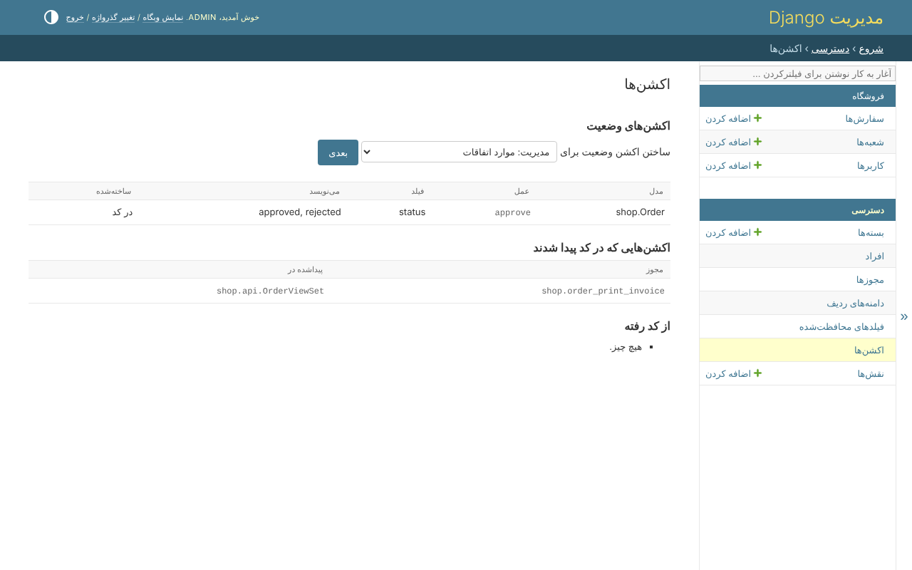
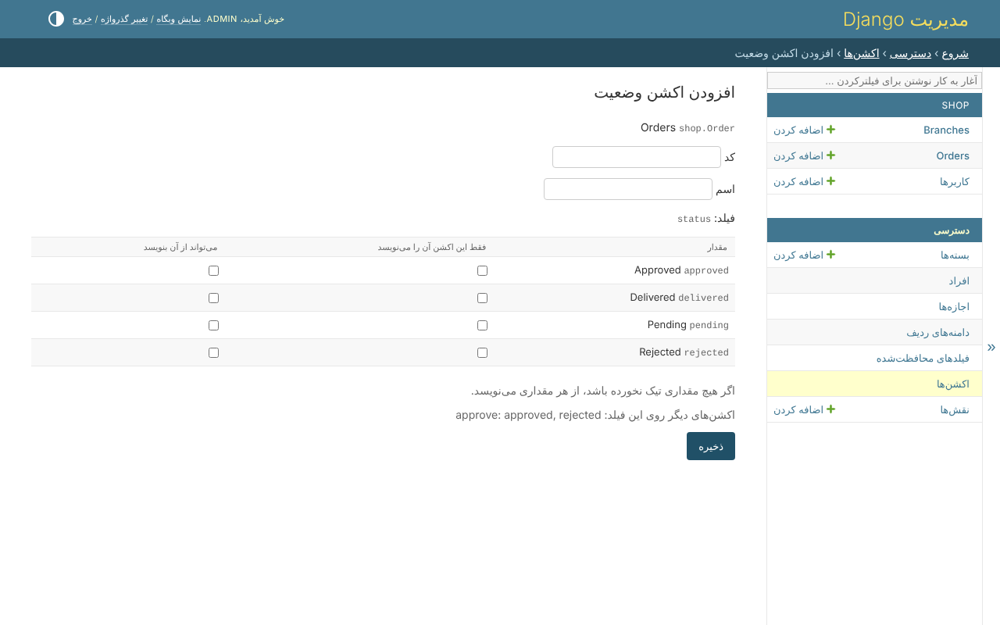

# اکشن‌ها

یک مدل جز مشاهده، ساختن، ویرایش و حذف، اکشن‌هایی دارد که پروژه‌اش به آن می‌دهد.
*دسترسی*، *اکشن‌ها* هر دو نوع را نشان می‌دهد:

## اکشن‌های وضعیت

اکشن وضعیت اکشنی است که مقدار می‌نویسد: فقط کسی که اجازه‌ی تأیید دارد سفارشی را
*approved* یا *rejected* می‌کند. کدی لازم ندارد.

*ساختن اکشن وضعیت برای*، یک مدل، *بعدی*؛ بعد فیلدی که می‌نویسد - فیلدی با گزینه،
یا بله و نه - و بعد:

| ستون | تیک چه می‌گوید |
|---|---|
| فقط این اکشن آن را می‌نویسد | کسی که این اکشن را ندارد نمی‌تواند این مقدار را بنویسد |
| می‌تواند از آن بنویسد | اکشن فقط از این مقدارها می‌نویسد؛ هیچ تیکی یعنی از هر مقداری |

ذخیره‌ی آن مجوزش را می‌سازد - `shop.order_<code>`، برای سفارش‌های فروشگاه - که تا
داده نشود هیچ کس آن را ندارد. مقداری که هیچ اکشنی ادعایش نکرده را هر کسی که بتواند
ردیف را ویرایش کند می‌نویسد. *اکشن‌های دیگر روی این فیلد* می‌گوید اکشن‌های دیگرِ
همین فیلد از قبل چه چیزی را ادعا کرده‌اند.

اکشن وضعیتی که در کد تعریف شده - در `build_permissions`، یا در فایل `ACCESS` - با
*در کد* و فقط‌خواندنی نشان داده می‌شود.

## اکشن‌هایی که در کد پیدا شدند

اکشنی که کار تازه‌ای می‌کند - فاکتوری چاپ می‌کند، فایلی خروجی می‌دهد - کد است، اما
مجوزش نیست: `migrate` آن را پیدا می‌کند و می‌سازد.

| در کد | می‌شود |
|---|---|
| یک `@action` در DRF روی viewsetی که از policy می‌پرسد | `<codename>_<action>` |
| `policy_action = '...'` روی یک view | همان |
| `@policy_required(policy, '...')` روی یک view تابعی | همان |
| یک اکشن ادمین بدون `permissions=` | همان |

صفحه هر کدام را فهرست می‌کند، و اینکه کجا پیدا شده. *از کد رفته* مجوزهایی را
فهرست می‌کند که دیگر چیزی آن‌ها را بررسی نمی‌کند - اکشنی که برداشته شده، یا مجوزی که
با دست ساخته شده - تا حذف شوند، یا توضیح داده شوند.

## آنچه رد می‌شود

* فیلدی بدون گزینه که بله و نه هم نیست، مقداری که از مقدارهای فیلد نیست، کدی که مدل
  از قبل دارد؛
* آزاد کردن یک مقدار، یا حذف اکشن، بدون داشتن آن روی همه‌ی ردیف‌ها - آن مقدار را
  بعد هر کسی که بتواند ویرایش کند می‌نوشت؛
* اجازه دادن به اکشنی که از مقدارهای بیشتری بنویسد - به هر کسی که آن را دارد بیشتر
  می‌دهد. این کار ابرکاربر است، یا فایل `ACCESS`.
