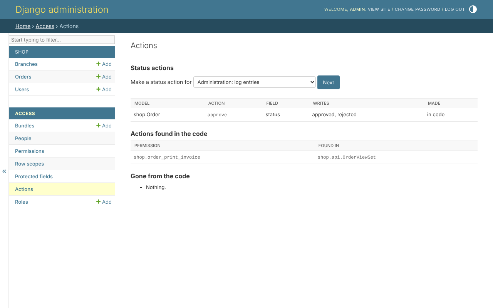
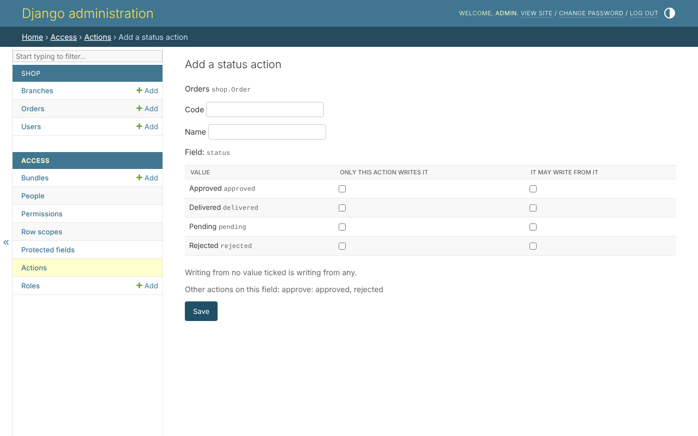

# Actions

Beyond view, create, edit and delete, a model has the actions its project
gives it. *Access*, *Actions* shows both kinds:

## Status actions

A status action is an action that writes values: only whoever may approve
sets an order to *approved* or *rejected*. It needs no code.

*Make a status action for*, a model, *Next*; then the field it writes - a
field with choices, or yes or no - and then:

| column | what a tick says |
|---|---|
| Only this action writes it | whoever lacks the action cannot write this value |
| It may write from it | the action writes only from these values; none ticked is from any |

Saving it makes its permission - `shop.order_<code>`, for the shop's
orders - held by nobody until it is given. A value no action claims is
written by whoever may edit the row. *Other actions on this field* lists what other actions on the same
field already claim.

A status action declared in code - in `build_permissions`, or the `ACCESS`
file - is shown *in code*, read only.

## Actions found in the code

An action that does something new - prints an invoice, exports a sheet - is
code, but its permission is not: `migrate` finds it and makes it.

| in the code | becomes |
|---|---|
| a DRF `@action` on a viewset asking a policy | `<codename>_<action>` |
| `policy_action = '...'` on a view | the same |
| `@policy_required(policy, '...')` on a function view | the same |
| an admin action with no `permissions=` | the same |

The page lists each, and where it was found. *Gone from the code* lists the
permissions nothing checks any more - an action removed, or one made by hand
- to be deleted, or explained.

## What is refused

* a field with no choices that is not yes or no, a value not one of the
  field's, a code the model has already;
* releasing a value, or deleting the action, without holding it on every
  row - the value would be written by whoever may edit;
* letting an action write from more values - it gives whoever holds it more.
  That is the superuser's, or the `ACCESS` file's.
