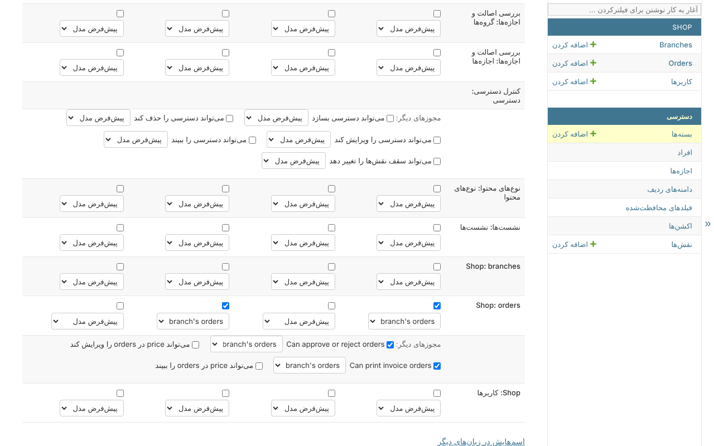

# بسته‌ها

بسته همان `Group` در Django است: مجوزهایی که با هم داده می‌شوند، هر کدام با یک
**دامنه** - اینکه به کدام ردیف‌ها می‌رسد. *دسترسی*، *بسته‌ها* آن‌ها را فهرست
می‌کند، با تعداد مجوزهای هر کدام و تعداد افراد:


بسته‌ای که یک نقش به افراد می‌دهد علامت *از نقششان* دارد - افرادش در صفحه‌ی خود
آن نام برده می‌شوند.

## ساختن یک بسته

*افزودن بسته*: یک اسم، و جدول.

جدول در هر ردیف یک مدل دارد و در هر ستون یک اکشن - *مشاهده*، *ساختن*، *ویرایش*،
*حذف*. یک مجوز را تیک بزنید و دامنه‌اش را کنارش انتخاب کنید:



* **دامنه** این‌ها را پیشنهاد می‌کند: *all*، دامنه‌های کد مدل - *سفارش‌های
  شعبه‌شان*، *سفارش‌های خودشان* - و دامنه‌های قانونی‌ای که برایش ساخته شده.
  *پیش‌فرض مدل* چیزی است که مدل بدون دامنه به آن می‌رسد، که در مدلی که queryset
  آن پیش‌فرضی نام نمی‌برد، هیچ ردیفی نیست.
* **مجوزهای دیگر** - اکشنی جز آن چهار، دو مجوز یک فیلد محافظت‌شده، اکشنی که در کد
  پیدا شده - در سطر جدای خودشان می‌آیند، زیر چهار مجوز مدل، هر کدام با دامنه‌ی
  خودش.
* مدلی که مجوزهای Django را دارد - `view_branch`، `add_branch` - در همین جدول و
  زیر همین چهار ستون است.

زیر جدول، *دارندگان* همه‌ی کسانی را نام می‌برد که بسته را دارند: کسانی که به آن‌ها
داده شده، و بعد کسانی که از راه نقششان با آن شروع می‌کنند، با علامت *از نقششان*.

## دادن آن

بسته در [صفحه‌ی یک شخص](people.md) داده می‌شود، یا یک [نقش](roles.md) آن را به
همه‌ی دارندگانش می‌دهد.

## تغییر و حذف

ذخیره‌ی جدول همان لحظه چیزی را که همه‌ی دارندگان بسته می‌توانند بکنند تغییر می‌دهد.
حذف آن اول می‌گوید از چه کسانی می‌گیرد - کسانی که از راه نقششان آن را دارند هم.
بسته‌ای که در فایل `ACCESS` تعریف شده فقط‌خواندنی نشان داده می‌شود، بدون *ذخیره*
و بدون *حذف*.

## آنچه رد می‌شود

* گذاشتن مجوزی که خودتان ندارید، یا با دامنه‌ای وسیع‌تر از دامنه‌ای که آن را دارید -
  مگر اینکه آن را با *all* داشته باشید؛
* تغییر بسته‌ای که خودتان دارید؛
* تغییری که بعد از آن هیچ کس جز ابرکاربر نتواند دسترسی را مدیریت کند.

[قانون‌های ایمنی](safety-rules.md) را ببینید.

## همین، در کد

```python
from clearance.services import AccessService

access = AccessService(actor=request.user)

managers = access.create_bundle(
    'Branch managers',
    grants={'shop.order_view': 'branch', 'shop.order_edit': 'branch'},
)
access.give_bundle(person, managers)
```
