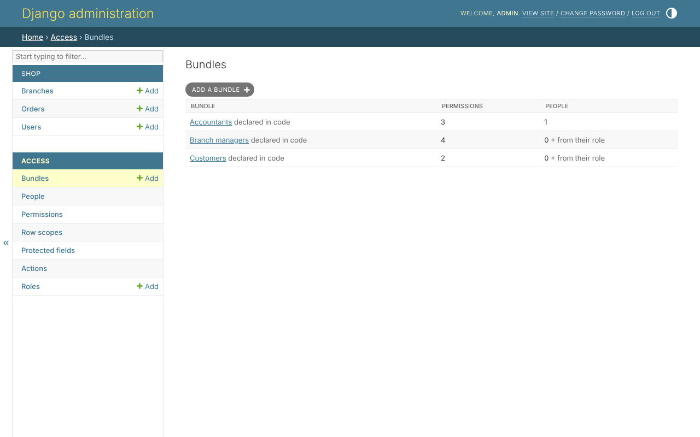
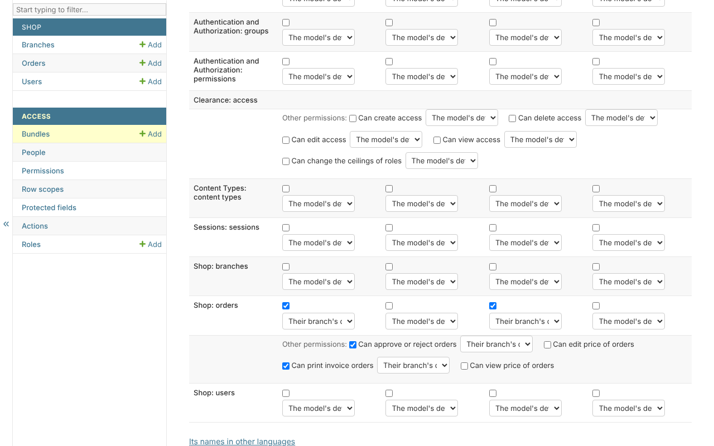

# Bundles

A bundle is Django's `Group`: permissions given together, each with a
**scope** - which rows it reaches. *Access*, *Bundles* lists them, with how
many permissions each holds and how many people:



A bundle a role starts people with is marked *from their role* - its people
are named on its own page.

## Making one

*Add a bundle*: a name, and the grid.

The grid has a model in each row and an action in each column - *view*,
*create*, *edit*, *delete*. Tick a permission, and choose its scope beside
it:



* **The scope** offers *all*, the model's scopes in code - *Their branch's
  orders*, *Their own orders* - and the rule scopes built for it. *The
  model's default* is what the model reaches with no scope, which is no rows
  on a model whose queryset names no default.
* **Other permissions** - an action beyond the four, a protected field's two
  permissions, an action found in the code - are on a line of their own,
  under the model's four, each with its own scope.
* A model whose permissions are Django's - `view_branch`, `add_branch` -
  is in the same grid, under the same four columns.

Below the grid, *Held by* names everybody who holds the bundle: the people
given it, then the people who start with it by their role, marked *from
their role*.

## Giving it

A bundle is given on a [person's page](people.md), or by a
[role](roles.md) to everybody who has it.

## Changing and deleting

Saving the grid changes what everybody holding the bundle may do, at once.
Deleting it says first whom it takes from - including those who start with
it by their role. A bundle declared in the `ACCESS` file is shown read only,
with no *Save* and no *Delete*.

## What is refused

* putting in a permission you do not hold, or with a wider scope than you
  hold it with - unless you hold it with *all*;
* changing a bundle you hold yourself;
* a change after which nobody but the superuser could manage access.

See [the safety rules](safety-rules.md).

## The same, in code

```python
from clearance.services import AccessService

access = AccessService(actor=request.user)

managers = access.create_bundle(
    'Branch managers',
    grants={'shop.order_view': 'branch', 'shop.order_edit': 'branch'},
)
access.give_bundle(person, managers)
```
