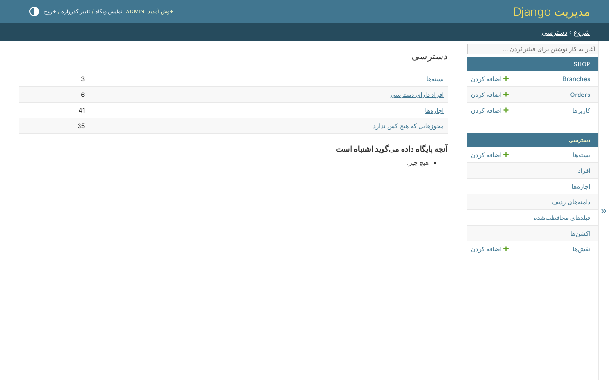

# پنل ادمین

هر چیزی درباره‌ی دسترسی در خود پنل ادمین Django و بدون کد تصمیم گرفته می‌شود:
چه کسی کدام مجوزها را دارد، هر کدام به کدام ردیف‌ها می‌رسد، کدام فیلدها
محافظت‌شده‌اند، کدام مقدارها را فقط بعضی می‌توانند بنویسند، و یک نقش چه چیزی را
هیچ‌وقت نمی‌تواند داشته باشد. این بخش همه‌ی صفحه‌ها را، یکی یکی، نشان می‌دهد.

## روشن کردن

اپ ادمین کتابخانه را به جای اپ Django بنویسید - چیز دیگری در پروژه عوض نمی‌شود،
و کلاس‌های `ModelAdmin` شما همان‌طور که Django می‌گوید می‌مانند:

```python
INSTALLED_APPS = [
    'clearance.admin.apps.ClearanceAdminConfig',   # instead of 'django.contrib.admin'
    ...
]
```

صفحه‌های دسترسی زیر *دسترسی* هستند، کنار اپ‌های خود شما. بدون اپ ادمین این
صفحه‌ها وجود ندارند، و چیز دیگری عوض نمی‌شود.

## چه کسی می‌تواند از صفحه‌ها استفاده کند

صفحه‌ها مجوزهای خود کتابخانه را لازم دارند، که مثل هر مجوز دیگری داده می‌شوند -
در یک بسته، یا به یک نفر:

| مجوز | اجازه می‌دهد |
|---|---|
| `clearance.permission_view` | همه‌ی صفحه‌های دسترسی را ببیند |
| `clearance.permission_create` | بسته، دامنه‌ی قانونی، اکشن وضعیت و نقش بسازد |
| `clearance.permission_edit` | آن‌ها را تغییر دهد، و بسته‌ها، نقش‌ها و مجوزها را بدهد و بگیرد |
| `clearance.permission_delete` | آن‌ها را حذف کند |
| `clearance.role_ceiling_edit` | سقف یک نقش را تغییر دهد |

تا وقتی به کسی داده نشوند، فقط ابرکاربر آن‌ها را دارد. کسی که دسترسی را مدیریت
می‌کند هم تابع [قانون‌های ایمنی](safety-rules.md) است: هیچ کس چیزی را که ندارد
نمی‌دهد، و دسترسی خودش را تغییر نمی‌دهد.

## نمای کلی

*دسترسی* با نمای کلی باز می‌شود: چند بسته، چند نفر دارای دسترسی و چند مجوز
وجود دارد، چند مجوز را هیچ کس ندارد - و آنچه در پایگاه داده هست و دسترسی‌ای
نمی‌دهد، یا شاید منظور نبوده:



*آنچه پایگاه داده می‌گوید اشتباه است* همان چیزی است که `clearance_check` می‌گوید،
روی صفحه: دامنه‌ی قانونی‌ای که دیگر درست درنمی‌آید، اکشن وضعیتی که فیلدش رفته،
مجوزی که دامنه‌اش را مدلش دیگر ندارد.

## تعریف‌شده در کد

آنچه فایل `ACCESS` یا کد تعریف می‌کند - یک بسته، یک نقش، یک فیلد محافظت‌شده، یک
اکشن وضعیت - با *تعریف‌شده در کد* و فقط‌خواندنی نشان داده می‌شود. اگر در پنل
ادمین تغییر می‌کرد، با sync بعدی برمی‌گشت؛ در خود فایل تغییر داده می‌شود.

## صفحه‌ها

| صفحه | چه کاری آن‌جا انجام می‌شود |
|---|---|
| [مدل‌های خود شما](your-models.md) | هیچ - هر صفحه‌ی هر مدل خودش از قانون‌ها می‌پرسد |
| [بسته‌ها](bundles.md) | مجوزهایی که با هم داده می‌شوند، هر کدام با یک دامنه |
| [افراد](people.md) | همه‌ی دسترسی یک شخص، و اینکه هر مجوز از کجا آمده |
| [مجوزها](permissions.md) | همه‌ی مجوزها، و اینکه چه کسی هر کدام را دارد |
| [دامنه‌های ردیف](row-scopes.md) | سازنده‌ی قانون |
| [فیلدهای محافظت‌شده](protected-fields.md) | فیلدی که با یک مجوز خوانده و با مجوز دیگری نوشته می‌شود |
| [اکشن‌ها](actions.md) | اکشن‌های وضعیت، و اکشن‌هایی که در کد پیدا شدند |
| [نقش‌ها](roles.md) | با `clearance.roles`: بسته‌های آغازین و سقف‌ها |
| [اسم‌ها](names.md) | با `clearance.translations`: یک اسم در هر زبان |
| [قانون‌های ایمنی](safety-rules.md) | آنچه همه‌ی صفحه‌ها رد می‌کنند |

عکس‌ها از [فروشگاه نمونه](../tutorial/01-the-shop.md) هستند، که یک اسکریپت هر بار
از خود صفحه‌ها می‌گیرد - به انگلیسی، و در صفحه‌های فارسی به فارسی.
