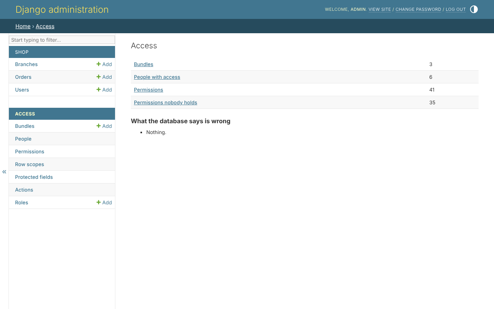

# The admin panel

Everything about access is decided in Django's own admin site, with no code:
who holds which permissions, which rows each reaches, which fields are
protected, which values only some may write, and what a role can never hold.
This section walks through every page, one at a time.

## Turning it on

Name the library's admin app in place of Django's - nothing else in the
project changes, and your `ModelAdmin` classes stay as Django documents them:

```python
INSTALLED_APPS = [
    'clearance.admin.apps.ClearanceAdminConfig',   # instead of 'django.contrib.admin'
    ...
]
```

The access pages are under *Access*, beside your own apps. Without the admin
app, they do not exist, and nothing else changes.

## Who may use the pages

The pages need the library's own permissions, given like any other - in a
bundle, or to one person:

| permission | lets them |
|---|---|
| `clearance.permission_view` | look at every access page |
| `clearance.permission_create` | make bundles, rule scopes, status actions and roles |
| `clearance.permission_edit` | change them, give and take bundles, roles and permissions |
| `clearance.permission_delete` | delete them |
| `clearance.role_ceiling_edit` | change a role's ceiling |

Only the superuser holds them until somebody is given them. Whoever manages
access is still held by the [safety rules](safety-rules.md): nobody gives
what they do not hold, or changes their own access.

## The overview

*Access* opens on the overview: how many bundles, people with access and
permissions there are, how many permissions nobody holds - and what the
database holds that gives no access, or may not be meant:



*What the database says is wrong* is what `clearance_check` says, on the
page: a rule scope that no longer checks out, a status action whose field is
gone, a grant whose scope its model no longer offers.

## Declared in code

What the `ACCESS` file or the code declares - a bundle, a role, a protected
field, a status action - is shown with *declared in code*, read only.
Changed in the admin site, it would come back on the next sync; it is
changed in the file.

## The pages

| page | what is done there |
|---|---|
| [Your own models](your-models.md) | nothing - every page of every model asks the rules by itself |
| [Bundles](bundles.md) | permissions given together, each with a scope |
| [People](people.md) | one person's whole standing, and where each permission came from |
| [Permissions](permissions.md) | every permission, and who holds it |
| [Row scopes](row-scopes.md) | the rule builder |
| [Protected fields](protected-fields.md) | a field read with one permission and written with another |
| [Actions](actions.md) | status actions, and the actions found in the code |
| [Roles](roles.md) | with `clearance.roles`: starting bundles and ceilings |
| [Names](names.md) | with `clearance.translations`: a name in every language |
| [The safety rules](safety-rules.md) | what every page refuses |

The pictures are of the [example shop](../tutorial/01-the-shop.md), taken
fresh from the pages by a script - in English, and in Persian on the Persian
pages.
