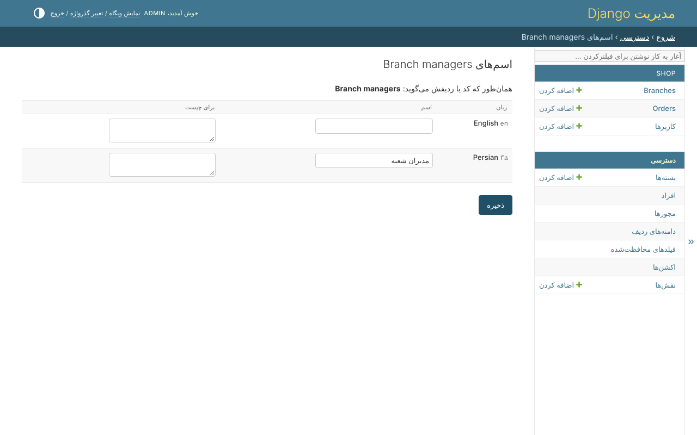

# اسم‌ها در همه‌ی زبان‌ها

صفحه‌ها، پیام‌ها و اسم مجوزهای کتابخانه به انگلیسی و فارسی هستند، و catalogue یک
پروژه برچسب‌هایی را که کدش می‌دهد ترجمه می‌کند. بسته یا نقش موقع اجرا ساخته
می‌شود، پس هیچ catalogueای اسم آن را ندارد.

وقتی `clearance.translations` نصب باشد، یک مجوز، یک بسته یا یک نقش در هر زبانی از
`LANGUAGES` نام‌گذاری می‌شود، از صفحه‌ی خودش - *اسم‌هایش در زبان‌های دیگر*، یا
*اسم‌ها* کنار یک مجوز:

هر زبان یک اسم می‌گیرد و یک خط که می‌گوید برای چیست. اسمی که خالی بماند مثل قبل
خوانده می‌شود.

## کدام اسم خوانده می‌شود

به زبان خواننده:

1. اسمی که این‌جا به آن زبان داده شده؛
2. وگرنه اسمی که به زبان پایه‌ی آن داده شده - `fa` برای `fa-ir`؛
3. وگرنه آنچه کد به آن زبان می‌گوید - برچسب‌های `build_permissions`، که catalogue
   پروژه ترجمه می‌کند؛
4. وگرنه خود ردیف.

پس همان بسته، وقتی به فارسی خوانده شود، در همه‌ی صفحه‌ها اسم فارسی‌اش را دارد:

اسم وقتی چیزی که نام می‌برد حذف شود از بین می‌رود. تغییر اسم‌ها
`clearance.permission_edit` لازم دارد.
