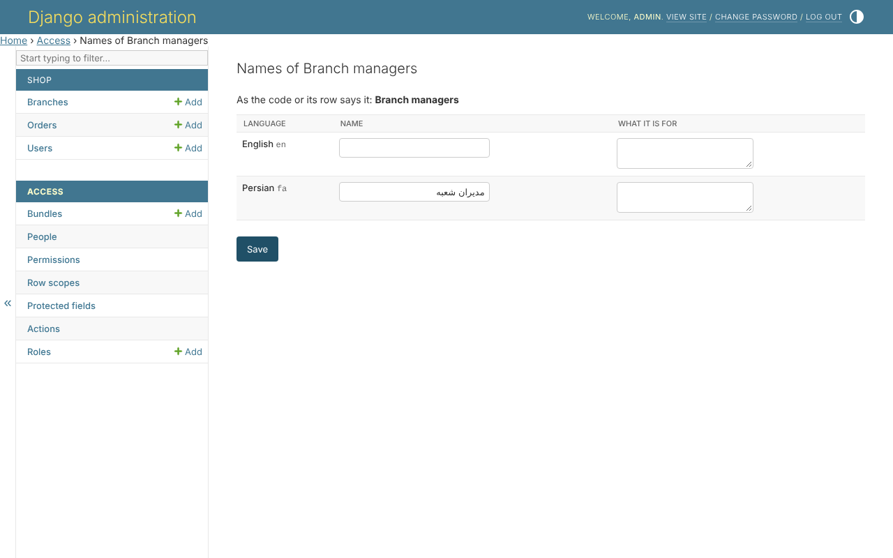

# Names in every language

The library's pages, messages and permission names come in English and
Persian, and a project's catalogue translates the labels its code gives. A
bundle or a role is made at runtime, so no catalogue holds its name.

With `clearance.translations` installed, a permission, a bundle or a role is
named in every language of `LANGUAGES`, from its page - *Its names in other
languages*, or *names* beside a permission:

Each language takes a name and a line saying what it is for. A name left
empty reads as before.

## Which name is read

In the reader's language:

1. the name given here in that language;
2. else the name given in its base language - `fa` for `fa-ir`;
3. else what the code says in that language - `build_permissions`' labels,
   which the project's catalogue translates;
4. else the row itself.

So the same bundle, read in Persian, has its Persian name on every page:

A name goes when the thing it names is deleted. Changing names needs
`clearance.permission_edit`.
