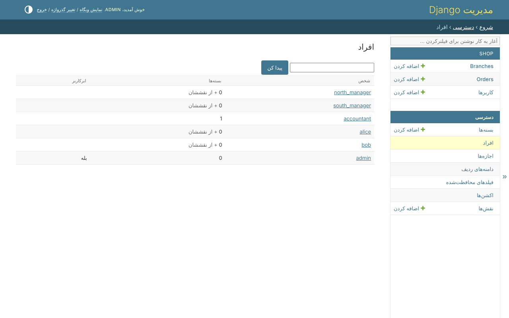
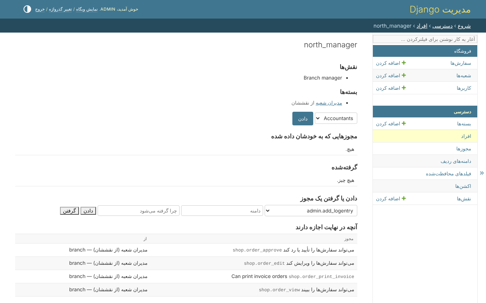

# افراد

*دسترسی*، *افراد* همه‌ی کسانی را فهرست می‌کند که هر دسترسی‌ای دارند - بسته‌ای که
داده شده یا از راه نقششان آمده، مجوزی که به خودشان داده شده، یا علامت ابرکاربر -
با بسته‌هایی که به هر کدام داده شده:



*پیدا کن* میان همه می‌گردد، با اسم و ایمیل، چه دسترسی داشته باشند چه نه.

## یک شخص

صفحه‌ی یک شخص همه‌ی دسترسی او را یک جا نشان می‌دهد:



| بخش | چه می‌گوید |
|---|---|
| نقش‌ها | اینکه شخص چیست، با `clearance.roles` |
| بسته‌ها | بسته‌هایی که به او داده شده، و آن‌هایی که *از نقششان* با آن‌ها شروع می‌کند |
| مجوزهایی که به خودشان داده شده | مجوزی که فقط به او داده شده، با دامنه‌اش |
| گرفته‌شده | مجوزی که از او گرفته شده، هر چه بسته‌هایش بگویند، و دلیلش |
| آنچه در نهایت اجازه دارند | هر مجوزی که در نهایت دارد، و اینکه هر کدام از کجا آمده - کدام بسته، یا مجوز خودش - با دامنه‌اش |

*آنچه در نهایت اجازه دارند* همان چیزی است که همه‌ی درها می‌پرسند: بسته‌ها و
مجوزهای مستقیم، منهای آنچه گرفته شده، در سقف نقش او.

## تغییر آن

از همین صفحه:

* **دادن** یک بسته، یا **پس گرفتن** بسته‌ای که داده شده. بسته‌ای که از نقش آمده
  این‌جا گرفته نمی‌شود - همراه نقش می‌آید.
* **دادن یک مجوز**، با یک دامنه - کد دامنه، مثل `branch`، یا خالی برای پیش‌فرض
  مدل.
* **گرفتن یک مجوز**، با دلیل - هر چه بسته‌هایش بدهند. زیر *گرفته‌شده* می‌آید، و
  *پس دادن* آن را برمی‌گرداند.

## آنچه رد می‌شود

* تغییر دسترسی خودتان - کس دیگری که دسترسی را مدیریت می‌کند آن را انجام می‌دهد، یا
  ابرکاربر؛
* دادن بسته یا مجوزی که خودتان ندارید، یا با دامنه‌ای وسیع‌تر؛
* گرفتن `permission_edit` از آخرین کسی، جز ابرکاربر، که می‌تواند دسترسی را مدیریت
  کند.

[قانون‌های ایمنی](safety-rules.md) را ببینید.

## همین، در کد

```python
access = AccessService(actor=request.user)

access.give_bundle(person, managers)
access.grant(person, 'shop.order_view', 'branch')
access.revoke(person, 'shop.order_edit', reason='Under review')
access.restore(person, 'shop.order_edit')
```
