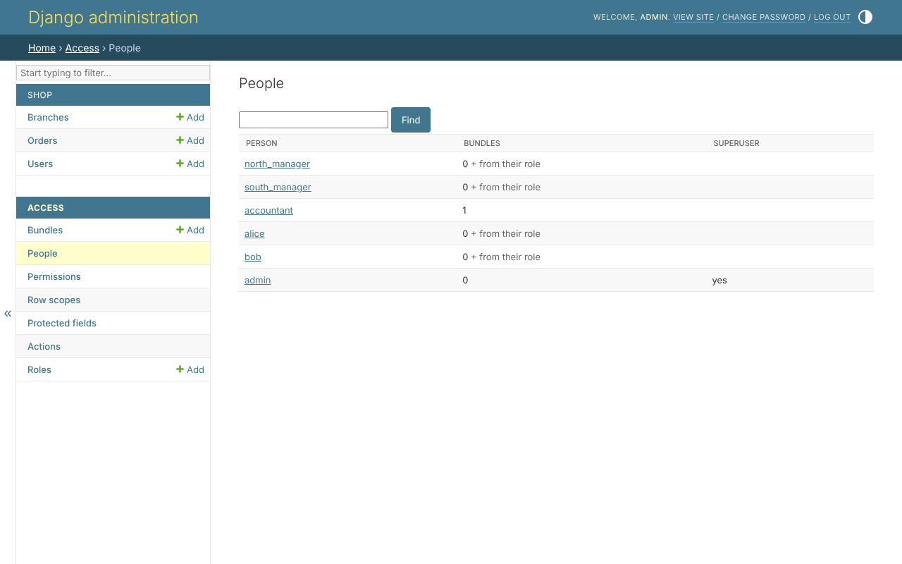
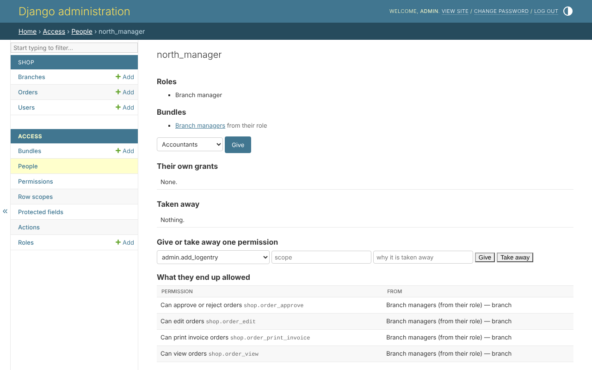

# People

*Access*, *People* lists everybody with any access - a bundle given or
started by their role, a permission of their own, or the superuser's flag -
with the bundles each was given:



*Find* looks through everybody, by name and e-mail address, with access or
without.

## One person

A person's page is their whole standing, in one place:



| part | what it says |
|---|---|
| Roles | what they are, with `clearance.roles` |
| Bundles | the bundles given them, and those they start with *from their role* |
| Their own grants | a permission given to them alone, with its scope |
| Taken away | a permission taken from them, whatever their bundles say, and why |
| What they end up allowed | every permission they hold in the end, and where each came from - which bundle, or their own grant - with its scope |

*What they end up allowed* is what every door asks: the bundles and grants,
less what was taken away, within their role's ceiling.

## Changing it

From the same page:

* **Give** a bundle, or **Take back** one given. A bundle started by their
  role is not taken here - it comes with the role.
* **Give one permission**, with a scope - the scope's code, such as
  `branch`, or empty for the model's default.
* **Take one away**, with the reason - whatever their bundles give. It shows
  under *Taken away*, and *Give back* undoes it.

## What is refused

* changing your own access - another person who manages access does it, or
  the superuser;
* giving a bundle or a permission you do not hold yourself, or with a wider
  scope;
* taking `permission_edit` from the last person, but the superuser, who
  could manage access.

See [the safety rules](safety-rules.md).

## The same, in code

```python
access = AccessService(actor=request.user)

access.give_bundle(person, managers)
access.grant(person, 'shop.order_view', 'branch')
access.revoke(person, 'shop.order_edit', reason='Under review')
access.restore(person, 'shop.order_edit')
```
