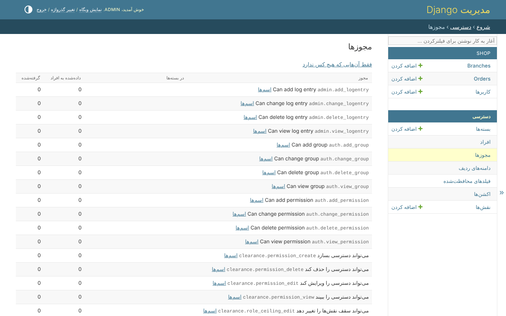

# مجوزها

*دسترسی*، *مجوزها* همه‌ی مجوزهای موجود را فقط‌خواندنی فهرست می‌کند: اسمش به زبان
خواننده، کدش، بسته‌هایی که آن را دارند، به چند نفر مستقیم داده شده، و از چند نفر
گرفته شده:

*فقط آن‌هایی که هیچ کس ندارد* فهرست را به مجوزهایی محدود می‌کند که در هیچ بسته‌ای
نیستند و به هیچ کس داده نشده‌اند. نسخه‌ی تازه‌ی یک پروژه، یک فیلد محافظت‌شده‌ی
تازه یا اکشنی که در کد پیدا شده مجوزهایی اضافه می‌کند که هیچ کس ندارد: این‌جا جایی
است که پیدا می‌شوند، تا داده شوند - یا دست‌نخورده بمانند.

با `clearance.translations`، *اسم‌ها* کنار هر مجوز [اسم‌های آن در هر
زبان](names.md) را باز می‌کند.

مجوز در این صفحه ساخته نمی‌شود. از کد می‌آید - چهار مجوز Django،
`build_permissions`، اکشنی که در کد پیدا شده - یا از صفحه‌های دیگر پنل ادمین: یک
[فیلد محافظت‌شده](protected-fields.md) دو مجوز می‌سازد، یک [اکشن
وضعیت](actions.md) یکی.
