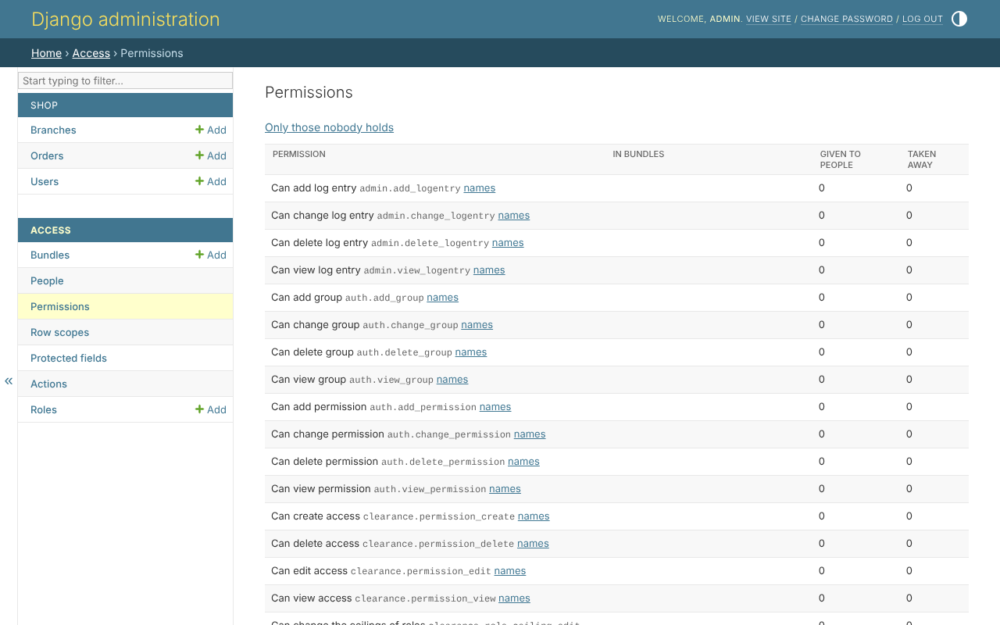

# Permissions

*Access*, *Permissions* lists every permission there is, read only: its name
in the reader's language, its code, the bundles holding it, how many people
were given it directly, and from how many it was taken away:

*Only those nobody holds* narrows it to the permissions in no bundle and
given to nobody. A new release of a project, a new protected field or an
action found in the code adds permissions held by nobody: this is where they
are found, to be given out - or left alone.

With `clearance.translations`, *names* beside each permission opens its
[names in every language](names.md).

A permission is not made on this page. It comes from the code - Django's
four, `build_permissions`, an action found in the code - or from the admin
site's other pages: a [protected field](protected-fields.md) makes two, a
[status action](actions.md) makes one.
