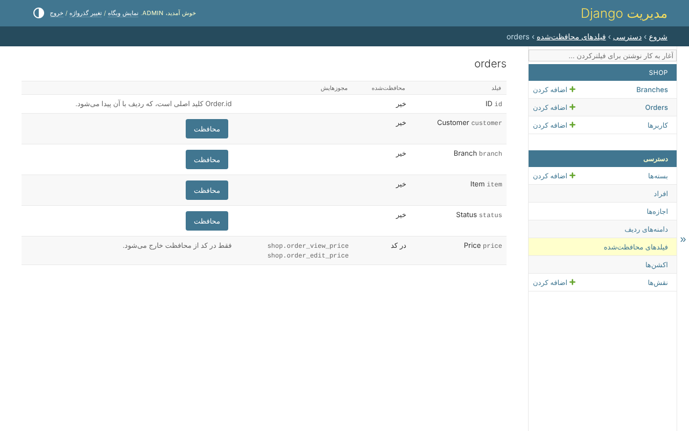

# فیلدهای محافظت‌شده

فیلد محافظت‌شده با یک مجوز خوانده و با مجوز دیگری نوشته می‌شود. *دسترسی*،
*فیلدهای محافظت‌شده* مدل‌ها را فهرست می‌کند، و هر مدل فیلدهایش را:



* **محافظت** فیلدی را علامت می‌زند و دو مجوزش را می‌سازد - `shop.order_view_price`
  و `shop.order_edit_price` در مدلی که مجوزهای خودش را تعریف می‌کند،
  `shop.view_order_price` و `shop.change_order_price` در مدلی که مجوزهای Django را
  نگه داشته.
* **برداشتن محافظت** هر دو را حذف می‌کند، و هر مجوزی را که از آن‌ها داده شده.
* فیلدی که **در کد** محافظت شده - `protected_fields=('price',)` - همین‌طور نشان داده
  می‌شود، و در کد از محافظت خارج می‌شود.
* از کلید اصلی و رمز عبور نمی‌شود محافظت کرد: یکی راه پیدا کردن ردیف است، و دیگری
  هیچ‌وقت نشان داده نمی‌شود.

## وقتی محافظت شد

هنوز هیچ کس دو مجوز آن را ندارد، پس از آن به بعد فقط ابرکاربر فیلد را می‌خواند، تا
بسته‌ای که آن‌ها را دارد داده شود. بعد همه‌ی درها آن را برای کسی که اجازه‌ی خواندنش
را ندارد کنار می‌گذارند، و برای کسی که می‌خواند و نمی‌نویسد قفل می‌کنند - [مدل‌های
خود شما](your-models.md) را ببینید.

## آنچه رد می‌شود

* محافظت از فیلدی که یک دامنه‌ی قانونی آن را می‌خواند - قانون به هر کس که می‌رسد
  می‌گفت در فیلد چیست؛ قانون‌ها نام برده می‌شوند، تا اول تغییر کنند؛
* برداشتن محافظت از فیلدی که هر دو مجوزش را ندارید - فیلدی را به شما می‌داد که
  هیچ‌وقت به شما داده نشده؛
* برداشتن محافظت از فیلدی که در کد محافظت شده.

## همین، در کد

```python
access = AccessService(actor=request.user)

access.protect_field(Order, 'price')
access.unprotect_field(Order, 'price')
```
