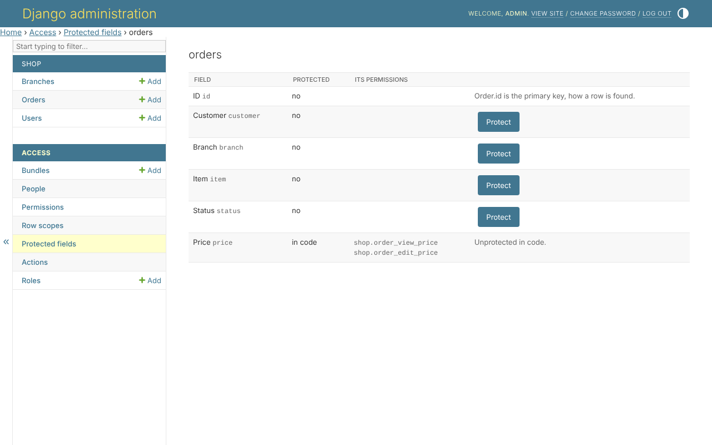

# Protected fields

A protected field is read with one permission and written with another.
*Access*, *Protected fields* lists the models, and each model its fields:



* **Protect** marks a field, and makes its two permissions -
  `shop.order_view_price` and `shop.order_edit_price` on a model declaring
  its own, `shop.view_order_price` and `shop.change_order_price` on one
  keeping Django's.
* **Unprotect** deletes both, and every grant of them.
* A field protected **in code** - `protected_fields=('price',)` - is shown
  as such, and unprotected in code.
* The primary key and the password cannot be protected: one is how a row is
  found, the other is never shown.

## Once it is protected

Nobody holds its two permissions yet, so from then on only the superuser
reads the field, until a bundle holding them is given out. Every door then leaves
it out for whoever may not read it, and locks it for whoever may read and
not write it - see [your own models](your-models.md).

## What is refused

* protecting a field a rule scope reads - the rule would tell whoever it
  reaches what the field holds; the rules are named, to be changed first;
* unprotecting a field you do not hold both permissions of - it would give
  you a field you were never given;
* unprotecting a field protected in code.

## The same, in code

```python
access = AccessService(actor=request.user)

access.protect_field(Order, 'price')
access.unprotect_field(Order, 'price')
```
