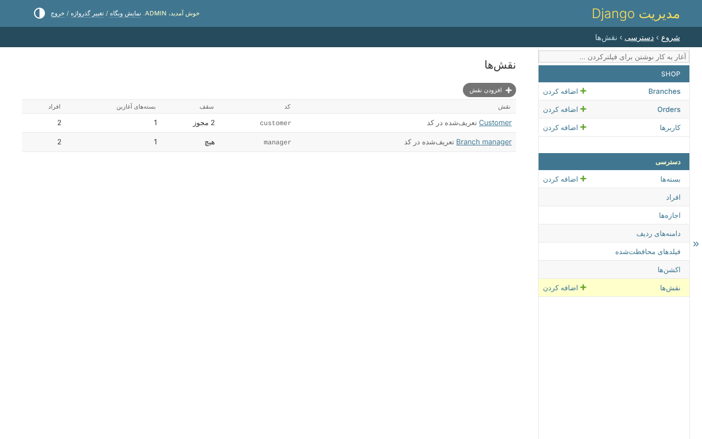
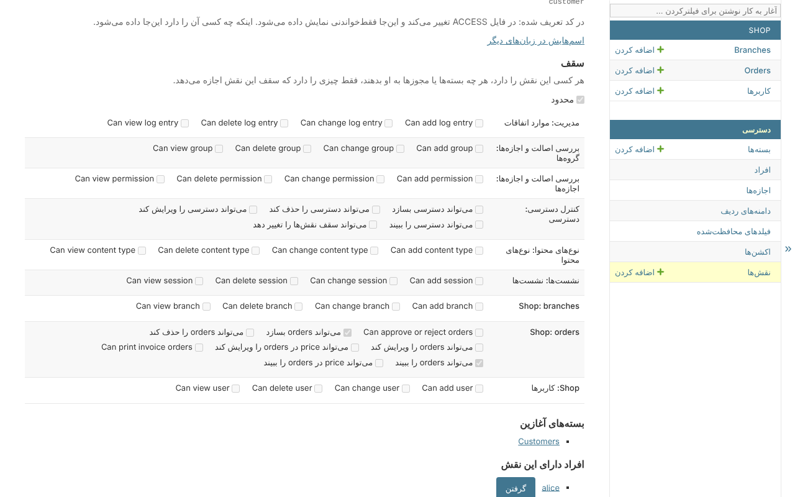

# نقش‌ها

وقتی `clearance.roles` نصب باشد، *دسترسی*، *نقش‌ها* نقش‌ها را فهرست می‌کند، با کد،
سقف، بسته‌های آغازین و افراد هر کدام:

نقش به همه‌ی کسانی که آن را دارند دو چیز می‌دهد:

* **بسته‌های آغازین** - که بدون اینکه یکی یکی داده شوند، دارندشان؛
* **یک سقف** - بیشترین چیزی که هر کسی با این نقش می‌تواند داشته باشد، هر چه یک بسته
  یا مجوز مستقیم به او بدهد.

## یک نقش

نقش *Customer*: محدود، با سقف دیدن و ساختن سفارش، که با بسته‌ی *Customers* شروع
می‌شود:

* **محدود** - بدون تیک، نقش چیزی را محدود نمی‌کند؛ با تیک، تیک‌های زیرش همه‌ی چیزی
  است که دارنده‌ی آن می‌تواند داشته باشد.
* **بسته‌های آغازین** - به همه‌ی دارندگان نقش داده می‌شوند.
* **افراد دارای این نقش** - همین‌جا داده و گرفته می‌شود.

نقش تازه محدود است و اجازه‌ی هیچ چیزی را نمی‌دهد، پس دادنش به کسی تا وقتی سقفش
تعیین نشده همه چیز را از او می‌گیرد - که راه امن است. کسی که چند نقش دارد در
اجتماع سقف‌هایش می‌ماند؛ یک نقش نامحدود سقف را کاملاً برمی‌دارد.

## سقف مجوز خودش را دارد

تغییر یک سقف `clearance.role_ceiling_edit` لازم دارد - که تا داده نشود فقط ابرکاربر
آن را دارد - و همین‌طور هر کاری که سقفی را از کسی برمی‌دارد: حذف یک نقش محدود، گرفتن
یک نقش محدود، یا دادن نقش دومی که آن را وسیع‌تر می‌کند. پس مدیرانی که بسته‌ها را
مدیریت می‌کنند نمی‌توانند آنچه یک نقش می‌تواند داشته باشد را وسیع‌تر کنند.

## آنچه رد می‌شود

* تغییر آنچه نقش خودتان دارد - سقفش، بسته‌های آغازینش، یا وجودش؛
* بسته‌ی آغازینی که مجوزی دارد که خودتان ندارید؛
* نقشی که در فایل `ACCESS` تعریف شده: سقف و بسته‌های آغازینش فقط‌خواندنی‌اند - اینکه
  چه کسی آن را دارد هنوز همین‌جا داده می‌شود.

## نقش‌هایی که روی کاربر نگه داشته می‌شوند

پروژه‌ای که نقش‌ها را روی مدل کاربرش نگه می‌دارد - یک ستون `role` - آن‌ها را با
`AttributeResolver` و `ROLE_ATTRIBUTE` می‌خواند. آن وقت نقش‌ها در صفحه‌ی کاربر، در
همان فیلد، داده می‌شوند، که فقط ابرکاربر آن را می‌نویسد: نوشتنش یعنی دادن یک نقش.
