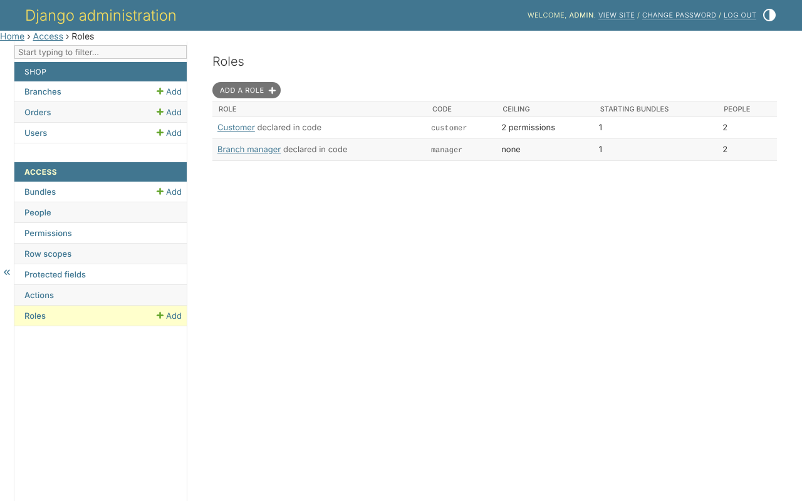
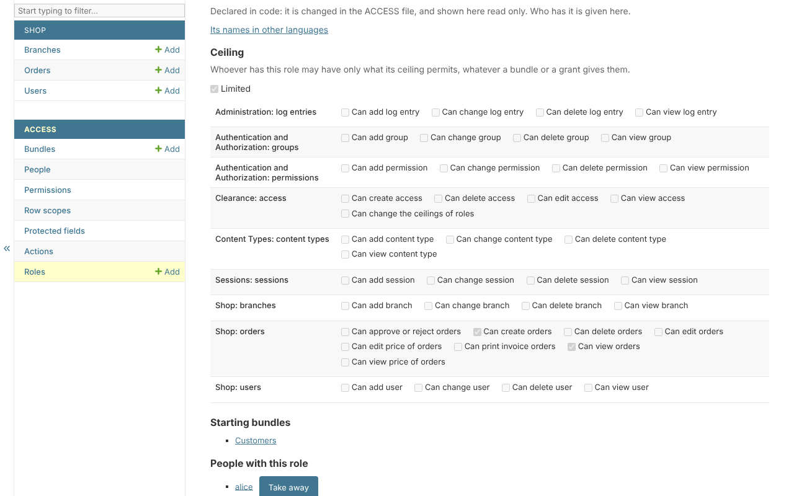

# Roles

With `clearance.roles` installed, *Access*, *Roles* lists the roles, with
each one's code, ceiling, starting bundles and people:

A role gives everybody who has it two things:

* **starting bundles** - held without being given one by one;
* **a ceiling** - the most anybody with the role may ever hold, whatever a
  bundle or a grant gives them.

## One role

The *Customer* role: limited, with a ceiling of viewing and creating orders,
starting with the bundle *Customers*:

* **Limited** - unticked, the role limits nothing; ticked, the ticks below are
  everything anybody with it may hold.
* **Starting bundles** - given to everybody with the role.
* **People with this role** - given here, and taken away.

A new role is limited and permits nothing, so giving it to somebody takes
everything from them until its ceiling is set - the safe way round. A person
with several roles holds within the union of their ceilings; one role that
is not limited lifts the ceiling altogether.

## The ceiling is its own permission

Changing a ceiling needs `clearance.role_ceiling_edit` - only the superuser
holds it until it is given - and so does anything that lifts one from
somebody: deleting a limited role, taking a limited role away, or giving a
second role that widens it. So administrators who manage bundles cannot
widen what a role may hold.

## What is refused

* changing what your own role holds - its ceiling, its starting bundles, or
  whether it exists;
* a starting bundle holding a permission you do not hold;
* a role declared in the `ACCESS` file: its ceiling and starting bundles are
  read only - who has it is still given here.

## Roles kept on the user

A project that keeps roles on its user model - a `role` column - reads them
with `AttributeResolver` and `ROLE_ATTRIBUTE`. Roles are then given on the
user's page, in that field, which only the superuser writes: writing it is
giving a role.
