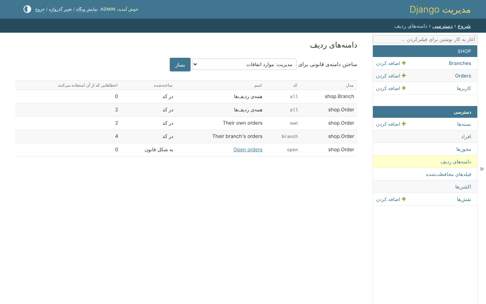
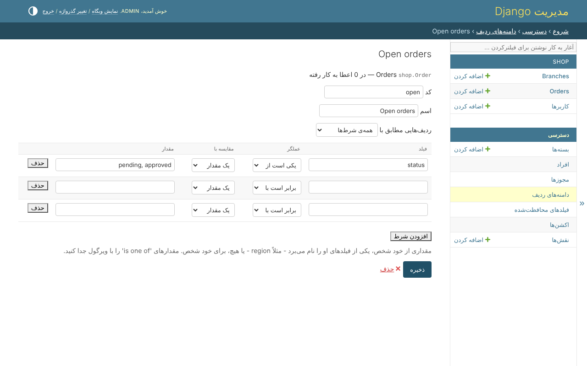

# دامنه‌های ردیف

دامنه می‌گوید یک مجوز به کدام ردیف‌ها می‌رسد. *دسترسی*، *دامنه‌های ردیف* همه‌ی
دامنه‌هایی را که هر مدل دارد فهرست می‌کند، اینکه چطور ساخته شده، و چند مجوز از آن
استفاده می‌کنند:



* **`all`** - همه‌ی ردیف‌ها - برای همه‌ی مدل‌ها هست.
* **در کد** - یک متد `scope_<code>` در queryset مدل، مثل *سفارش‌های شعبه‌شان*. در
  کد تغییر داده می‌شود.
* **به شکل قانون** - بدون کد، در همین صفحه ساخته می‌شود.

قانونی که دیگر درست درنمی‌آید علامت می‌خورد: تا درست نشود به هیچ ردیفی نمی‌رسد.

## ساختن یک قانون

*ساختن دامنه‌ی قانونی برای*، یک مدل، *بساز*. بعد:



| بخش | چیست |
|---|---|
| کد | اسم دامنه در کد و در فایل `ACCESS` - هیچ‌وقت `all`، هیچ‌وقت اسم یک دامنه‌ی کد |
| اسم | چیزی که جدول بسته نشان می‌دهد |
| ردیف‌هایی مطابق با | *همه‌ی شرط‌ها*، یا *هر کدام از شرط‌ها* |
| یک شرط | یک فیلد، یک عملگر، چیزی که با آن مقایسه می‌شود، و مقدار |

شرط با **یک مقدار** مقایسه می‌شود - `pending, approved`، که مقدارهای *یکی است از*
با ویرگول جدا می‌شوند - یا با **چیزی مال شخص**: *مال شخص* با یکی از فیلدهایش، مثل
`branch`، یا خالی، برای خود شخص.

```text
status      is one of   pending, approved
branch      is          the person's branch
customer    is          the person
```

عملگرها این‌ها هستند: *برابر است با*، *برابر نیست با*، *یکی است از*، *شامل*،
*خالی است*، *پیش از*، *پس از*، *دست‌کم* و *حداکثر*. *افزودن شرط* یک سطر اضافه
می‌کند؛ بدون اسکریپت صفحه، هر بار سه سطر پیشنهاد می‌شود.

## موقع ذخیره

هر شرط با مدل، همان‌طور که هست، بررسی می‌شود، و هر کدام که اشتباه باشد نام برده
می‌شود:

* فیلد باید وجود داشته باشد، حداکثر `RULE_DEPTH` رابطه دورتر - سه، مگر تنظیمات
  چیز دیگری بگویند؛
* عملگر باید به فیلد بخورد، و مقدار چیزی باشد که فیلد می‌تواند نگه دارد - وقتی فیلد
  گزینه دارد، یکی از گزینه‌هایش؛
* **هیچ شرطی فیلد محافظت‌شده یا رمز عبور را نمی‌خواند** - فیلتری روی قیمت به دارنده‌ی
  قانون می‌گفت قیمت چیست؛
* شرطی که به مدل دیگری می‌رسد - `customer__email` - آن مدل را می‌خواند، پس کسی که
  آن را می‌نویسد باید اجازه‌ی دیدن همه‌ی آن را داشته باشد.

بعد از ذخیره، قانون کنار هر مجوز مدلش پیشنهاد می‌شود، در جدول بسته و در صفحه‌ی
یک شخص.

## آنچه رد می‌شود

* تغییر ردیف‌های قانونی که مجوزهای خودتان در آن است - دسترسی خودتان را وسیع‌تر
  می‌کرد؛ تغییر اسم آن تغییری نیست؛
* تغییر ردیف‌های یک قانون بدون داشتن همه‌ی مجوزهایی که در آن داده شده، روی همه‌ی
  ردیف‌ها؛
* حذف قانونی که هنوز در مجوزی انتخاب شده - اول مجوزهایش را جابه‌جا کنید.

## همین، در کد

```python
from clearance.services import AccessService

AccessService(actor=request.user).create_scope_rule(
    Order,
    'open',
    'Open orders',
    [{'field': 'status', 'operator': 'is_one_of', 'value': {'constant': ['pending', 'approved']}}],
)
```
