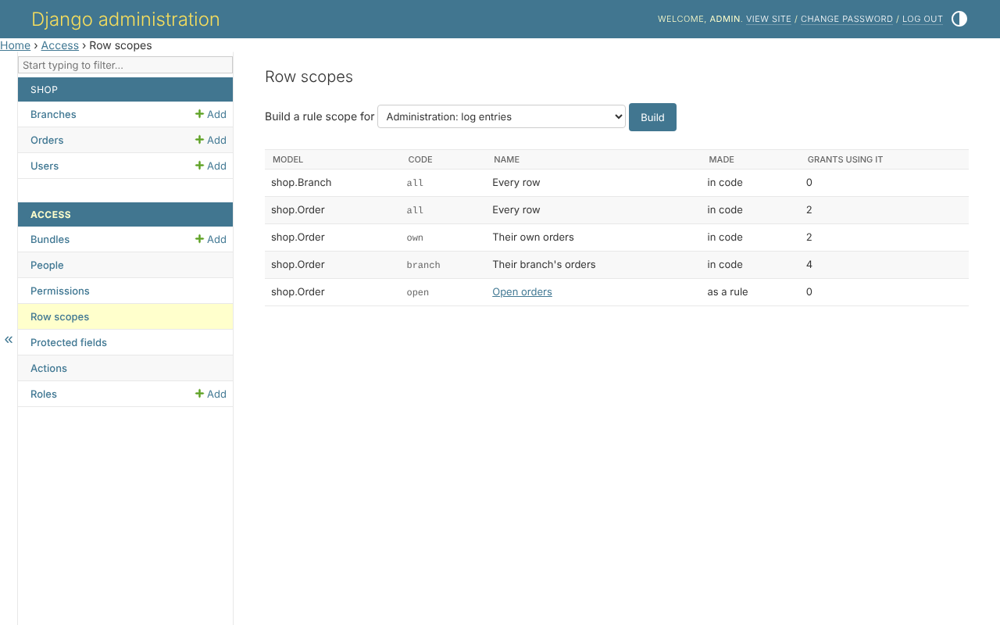
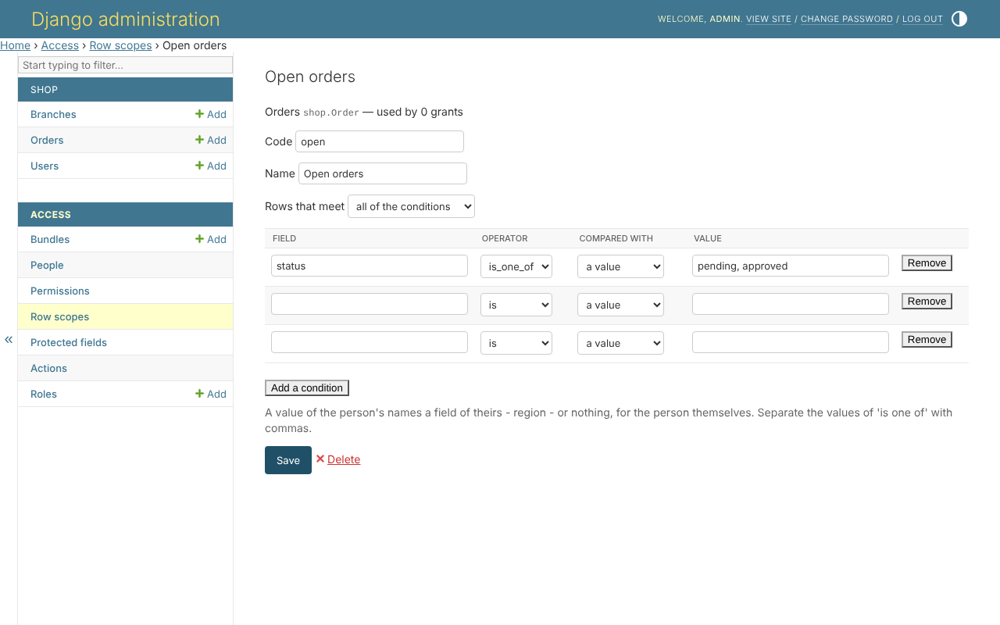

# Row scopes

A scope says which rows a permission reaches. *Access*, *Row scopes* lists
every scope each model offers, how it was made, and how many grants use it:



* **`all`** - every row - is offered for every model.
* **In code** - a `scope_<code>` method of the model's queryset, such as
  *Their branch's orders*. Changed in the code.
* **As a rule** - built on this page, with no code.

A rule that no longer checks out is marked: it reaches nothing until it is
mended.

## Building a rule

*Build a rule scope for*, a model, *Build*. Then:



| part | what it is |
|---|---|
| Code | the scope's name in the code and in the `ACCESS` file - never `all`, never a code scope's |
| Name | what the bundle grid shows |
| Rows that meet | *all of the conditions*, or *any of the conditions* |
| a condition | a field, an operator, what it is compared with, and the value |

A condition is compared with **a value** - `pending, approved`, the values of
*is one of* separated with commas - or with **something of the person's**:
*the person's* with a field of theirs, such as `branch`, or nothing, for the
person themselves.

```text
status      is one of   pending, approved
branch      is          the person's branch
customer    is          the person
```

The operators are *is*, *is not*, *is one of*, *contains*, *is empty*,
*before*, *after*, *at least* and *at most*. *Add a condition* adds a line;
without the page's script, three lines are offered at a time.

## When it is saved

Every condition is checked against the model as it is, and each one wrong is
named:

* the field must exist, at most `RULE_DEPTH` relations away - three, unless
  the settings say otherwise;
* the operator must suit the field, and a value be one it can hold - one of
  its choices, when it has them;
* **no condition reads a protected field, or the password** - a filter on the
  price would tell whoever holds the rule what the price is;
* a condition reaching another model - `customer__email` - reads that model,
  so whoever writes it must be allowed to view all of it.

Once saved, the rule is offered beside every permission of its model, in the
bundle grid and on a person's page.

## What is refused

* changing the rows of a rule your own grants are in - it would widen your
  own access; renaming it is no change;
* changing the rows of a rule without every permission granted in it, on
  every row;
* deleting a rule still chosen in a grant - move its grants first.

## The same, in code

```python
from clearance.services import AccessService

AccessService(actor=request.user).create_scope_rule(
    Order,
    'open',
    'Open orders',
    [{'field': 'status', 'operator': 'is_one_of', 'value': {'constant': ['pending', 'approved']}}],
)
```
