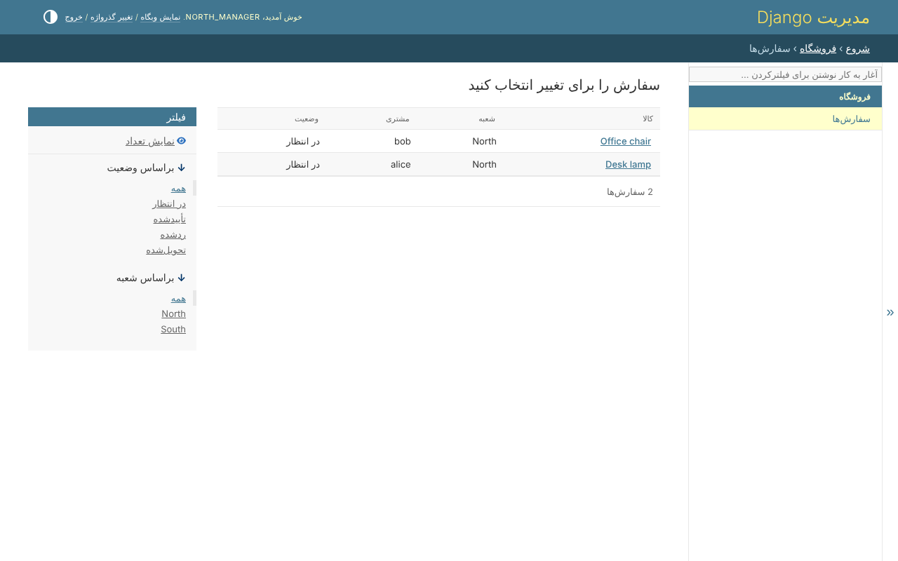
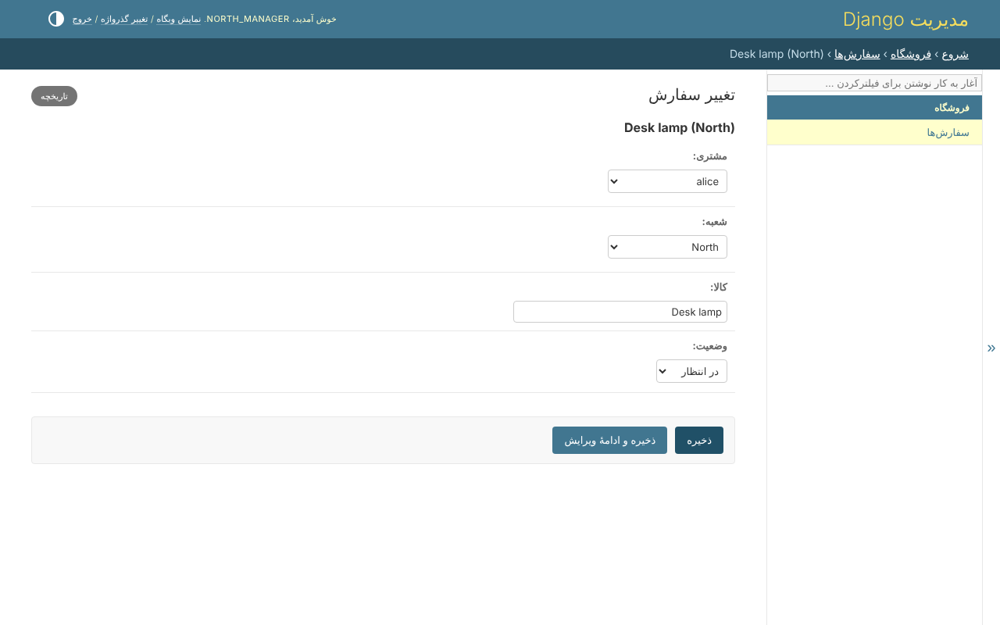
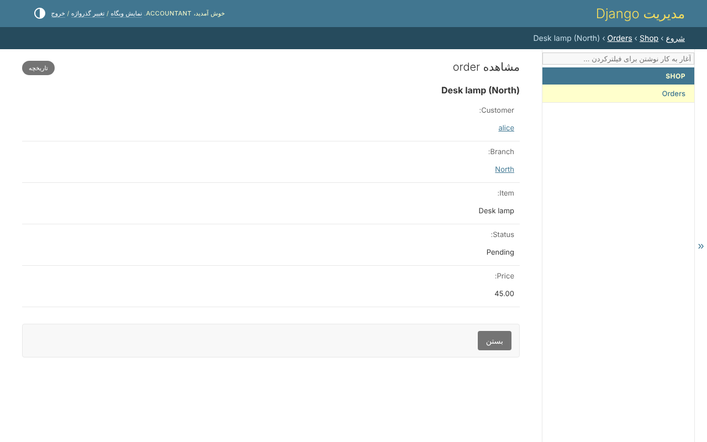

# مدل‌های خود شما

در `ModelAdmin` هیچ چیزی درباره‌ی دسترسی نوشته نمی‌شود. مال فروشگاه همان چیزی
است که Django می‌گوید، نه بیشتر:

```python
--8<-- "example/shop/admin.py"
```

پنل ادمین کتابخانه به هر `ModelAdmin`ی که ثبت می‌کند، و به هر inline آن، قانون‌ها
را می‌دهد - پس هر صفحه‌ی هر مدل به همان پرسش‌هایی جواب می‌دهد که API و viewها.

## چه کسی می‌تواند بازش کند

`has_view_permission`، `has_add_permission` و بقیه از policy مدل می‌پرسند - وقتی
ردیفی هست، با همان ردیف. هر کس در منو فقط مدل‌هایی را می‌بیند که می‌تواند با آن‌ها
کاری بکند: `north_manager` *Orders* را می‌بیند، و *Branches* یا *Users* را نه.

## کدام ردیف‌ها

فهرست، و هر ردیفی که باز شود، از ردیف‌هایی می‌آیند که شخص به آن‌ها می‌رسد. با
`north_manager`، فهرست سفارش‌ها دو سفارش North را دارد:



سفارشی از South برای او وجود ندارد: نشانی‌اش همان جوابی را می‌دهد که سفارشی که
هیچ‌وقت ثبت نشده.

## کدام فیلدها

فیلد محافظت‌شده‌ای که شخص اجازه‌ی خواندنش را ندارد از فرم، فهرست، جستجو، فیلترها
و مرتب‌سازی کنار گذاشته می‌شود - جستجو یا مرتب‌سازی با آن می‌گفت چه چیزی در آن
است. همان سفارش، وقتی `north_manager` و حسابدار بازش کنند:





مدیر می‌تواند سفارش را ویرایش کند و قیمت را نمی‌تواند بخواند، پس فرم قیمت ندارد.
حسابدار می‌تواند قیمت را بخواند و چیزی را ویرایش نمی‌کند، پس صفحه فقط‌خواندنی است
و قیمت را نشان می‌دهد. فیلدی که خوانده می‌شود و نوشته نمی‌شود قفل است، در فرم و
در `list_editable`.

## کدام مقدارها

فیلدی که یک اکشن وضعیت می‌نویسد فقط مقدارهایی را پیشنهاد می‌کند که شخص می‌تواند
بگذارد. روی یک سفارش در انتظار در شعبه‌ی خودش، به `north_manager` هر چهار وضعیت
پیشنهاد می‌شود: *approved* و *rejected* چون می‌تواند تأیید کند، *pending* و
*delivered* چون می‌تواند ویرایش کند. به کسی که می‌تواند ویرایش کند و نمی‌تواند تأیید
کند *pending* و *delivered* پیشنهاد می‌شود - و مقداری که سفارش از قبل دارد، چون نگه
داشتنش تغییری نیست.

## کدام اکشن‌های ادمین

اکشن ادمینی که پروژه نوشته فقط به کسی پیشنهاد می‌شود که مجوز آن را دارد، و فقط
روی ردیف‌های انتخاب‌شده‌ای اجرا می‌شود که دامنه‌اش به آن‌ها می‌رسد. اکشنی که
`permissions=` خود Django را نام می‌برد، پیشنهادش با Django است. *حذف انتخاب‌شده‌ها*
روی ردیف‌هایی اجرا می‌شود که شخص می‌تواند حذف کند.

## آنچه نوشته می‌شود

ردیفی که اضافه یا تغییر داده می‌شود باید میان ردیف‌هایی بماند که شخص می‌تواند
بنویسد: مدیر نمی‌تواند سفارشی را به شعبه‌ی دیگر ببرد، بیرون از دسترس خودش. حذفی که
از راه cascade ردیفی را ببرد که شخص اجازه‌ی حذفش را ندارد رد می‌شود. inline و
فهرست ویرایش‌پذیر ردیف‌هایی را نشان می‌دهند که شخص می‌تواند *ببیند*: ردیفی که
نمی‌تواند ویرایش کند آن‌جا قفل است، و ردیفی که نمی‌تواند حذف کند می‌ماند.

## مدل کاربر

در صفحه‌ی کاربر، گروه‌ها و مجوزهای یک شخص فقط‌خواندنی‌اند: در [صفحه‌ی
افراد](people.md) و زیر قانون‌های ایمنی تغییر داده می‌شوند. فیلدی هم که resolver نقش،
نقش‌ها را از آن می‌خواند همین‌طور است. فقط ابرکاربر کسی را ابرکاربر می‌کند، و فقط
ابرکاربر حساب یک ابرکاربر را تغییر می‌دهد - رمز عبورش هم، چون هر کس آن را بگذارد
با آن حساب وارد می‌شود. صفحه‌ی گروه خود Django برداشته شده: بسته همان گروه است، و
آن صفحه همه‌ی قانون‌ها را دور می‌زد.
