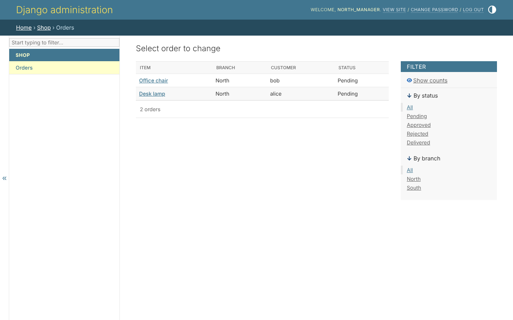
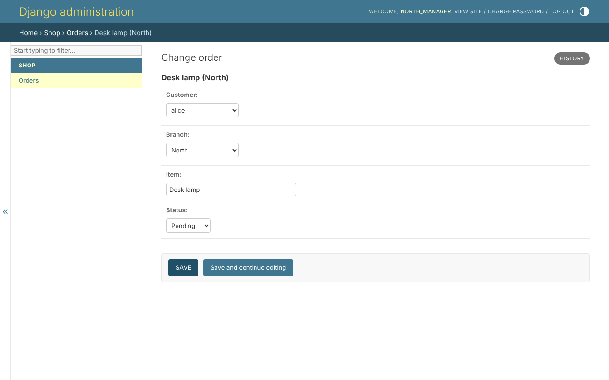
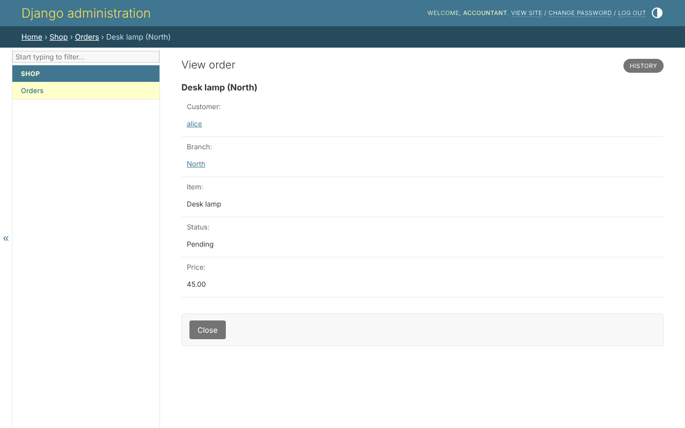

# Your own models

Nothing about access is written in a `ModelAdmin`. The shop's is what Django
documents, and no more:

```python
--8<-- "example/shop/admin.py"
```

The library's admin site gives every `ModelAdmin` it registers, and every
inline of one, the rules - so each page of each model answers the same
questions the API and the views do.

## Who may open it

`has_view_permission`, `has_add_permission` and the rest ask the model's
policy - with the row, when there is one. A person sees in the menu only the
models they may do something with: `north_manager` sees *Orders*, and not
*Branches* or *Users*.

## Which rows

The list, and every row opened, come from the rows the person reaches.
Signed in as `north_manager`, the list of orders holds North's two:



An order of South does not exist for them: its address answers as for an
order never placed.

## Which fields

A protected field the person may not read is left out of the form, the list,
the search, the filters and the ordering - searching or sorting by it would
tell what it holds. The same order, opened by `north_manager` and by the
accountant:





The manager may edit the order and may not read the price, so the form has
no price. The accountant may read the price and edit nothing, so the page is
read only and shows it. A field read but not written is locked, in the form
and in `list_editable`.

## Which values

A field a status action writes offers only the values the person may set. On
a pending order of their branch, `north_manager` is offered all four
statuses: *approved* and *rejected* because they may approve, *pending* and
*delivered* because they may edit. Somebody who may edit and not approve is
offered *pending* and *delivered* - and the value the order holds already,
since keeping it is no change.

## Which admin actions

An admin action the project wrote is offered only to whoever holds its
permission, and runs only over the selected rows its scope reaches. One
naming Django's `permissions=` is Django's to offer. *Delete selected* runs
over the rows the person may delete.

## What is written

A row added or changed must stay among the rows the person may write: a
manager cannot move an order to another branch, out of their reach. A delete
that would take, by a cascade, a row the person may not delete is refused.
An inline and the editable list show the rows the person may *view*: one
they may not edit is locked there, and one they may not delete is kept.

## The user model

On the user's page, a person's groups and permissions are read only: they are
changed on the [people page](people.md), under the safety rules. So is a
field the role resolver reads roles from. Only the superuser makes somebody
a superuser, and only the superuser changes a superuser's account - its
password included, because whoever sets it signs in as them. Django's own
group page is taken away: a bundle is a group, and that page wrote round
every rule.
