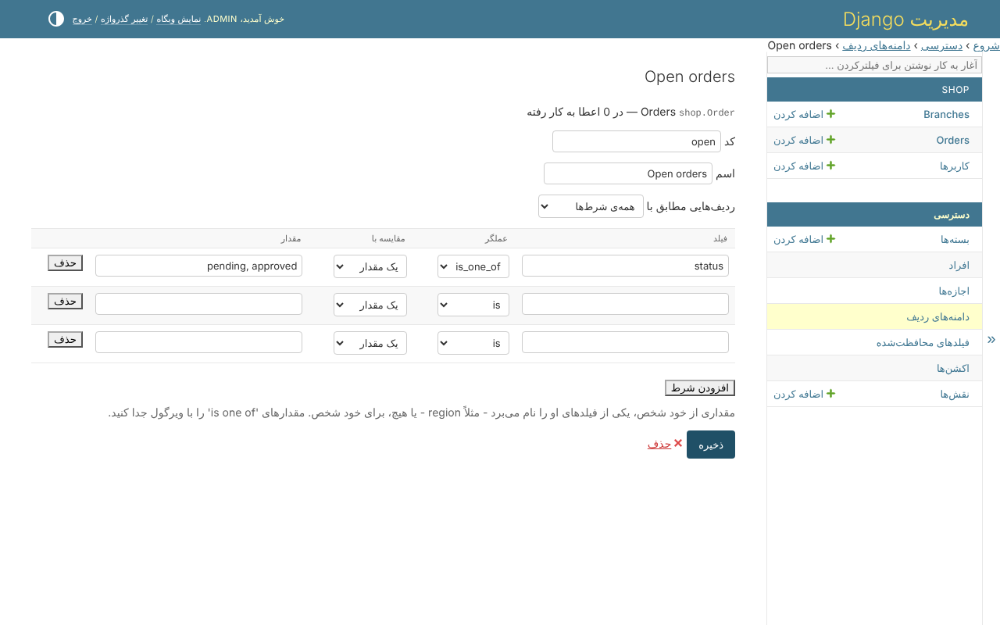

# django-clearance

کنترل دسترسی مبتنی بر نقش، سیاست (policy) و سطح ردیف برای جنگو. **پیش‌فرض: رد.**

مدیر سایت، در پنل ادمین Django و بدون هیچ کدی، تصمیم می‌گیرد چه کسی چه کاری
می‌تواند بکند - و روی کدام ردیف‌ها، و با کدام فیلدها.



<div class="grid cards" markdown>

- **بسته‌های** مجوز، که هر مجوز با یک **دامنه** داده می‌شود - «سفارش‌های شعبه‌ی
  خودشان»، «مال خودشان»، یا قانونی که در پنل ادمین ساخته شده.
- **فیلدهای محافظت‌شده**، که با یک مجوز خوانده و با مجوزی دیگر نوشته می‌شوند.
- **اکشن‌های وضعیت** - فقط کسی که اجازه‌ی تأیید دارد یک سفارش را *approved* می‌کند.
- **نقش‌ها**، به صورت اختیاری، با سقفی که هیچ کس با آن نقش از آن بالاتر نمی‌رود.

</div>

همه‌ی درها همان قانون‌ها را می‌پرسند: viewها و قالب‌های Django، DRF، پنل ادمین، و
کد خودتان. هر تغییری که بگذارد کسی به خودش بیشتر بدهد رد می‌شود. صفحه‌ها، پیام‌ها
و مجوزها به انگلیسی و فارسی هستند.

## نصب

```bash
pip install django-clearance            # with Django's views and admin site
pip install 'django-clearance[drf]'     # and Django REST framework
```

```python
INSTALLED_APPS = [
    'clearance.admin.apps.ClearanceAdminConfig',   # instead of 'django.contrib.admin'
    ...
    'clearance',
]

AUTHENTICATION_BACKENDS = ['clearance.backends.ClearanceBackend']
```

## بعد کجا بروید

| | |
|---|---|
| [راهنما](guide.md) | همه‌ی بخش‌های کتابخانه، و اینکه چطور به کارشان ببرید |
| [طراحی](design.md) | اینکه چرا این‌طور ساخته شده |
| [تغییرات](changelog.md) | اینکه هر نسخه چه چیزی را عوض کرد |
| [فروشگاه نمونه](https://github.com/amirAI-dot/django-clearance/tree/main/example) | پروژه‌ای که همه‌اش را به کار می‌برد، برای اجرا کردن |

Python 3.11 تا 3.14؛ Django 5.2، 6.0 و 6.1؛ Django REST framework 3.16 و بالاتر،
به صورت اختیاری؛ هر پایگاه داده‌ای که Django پشتیبانی می‌کند.
