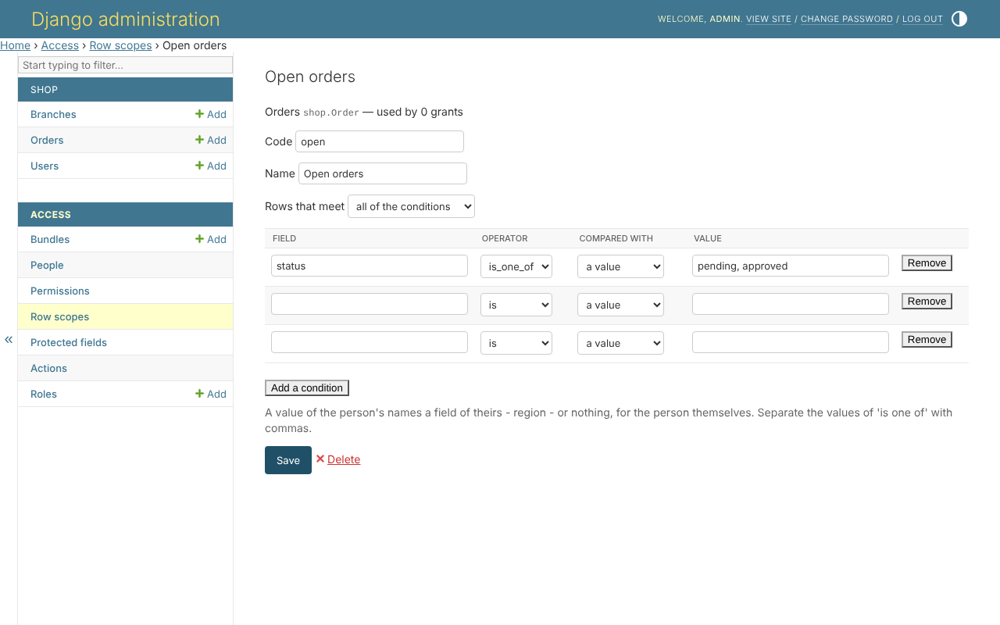

# django-clearance

Role, policy and row-level access control for Django. **Denied by default.**

An administrator decides, in Django's admin site and with no code, who may do
what - and to which rows, and with which fields.



<div class="grid cards" markdown>

- **Bundles** of permissions, each given with a **scope** - "their branch's
  orders", "their own", or a rule built in the admin site.
- **Protected fields**, read with one permission and written with another.
- **Status actions** - only whoever may approve sets an order to *approved*.
- **Roles**, optional, with a ceiling nobody with the role goes past.

</div>

Every door asks the same rules: Django's views and templates, DRF, the admin
site, and your own code. A change is refused when it would let somebody give
themselves more. The pages, messages and permissions come in English and
Persian.

## Install

```bash
pip install django-clearance            # with Django's views and admin site
pip install 'django-clearance[drf]'     # and Django REST framework
```

```python
INSTALLED_APPS = [
    'clearance.admin.apps.ClearanceAdminConfig',   # instead of 'django.contrib.admin'
    ...
    'clearance',
]

AUTHENTICATION_BACKENDS = ['clearance.backends.ClearanceBackend']
```

## Where to go next

| | |
|---|---|
| [Getting started](getting-started/introduction.md) | what it is for, installing it, and a first bundle in a few lines |
| [The tutorial](tutorial/index.md) | the example shop, built a layer at a time |
| [The admin panel](admin/index.md) | every access page, with pictures |
| [The reference](reference/index.md) | every setting, check, command, signal and model - and the Python API |
| [The guide](guide.md) | every part of the library, and how to use it |
| [The design](design.md) | why it is built the way it is |
| [The changelog](changelog.md) | what each release changed |
| [The example shop](https://github.com/amirAI-dot/django-clearance/tree/main/example) | a project using all of it, to run |

Python 3.11 to 3.14; Django 5.2, 6.0 and 6.1; Django REST framework 3.16 and
later, optional; any database Django supports.
