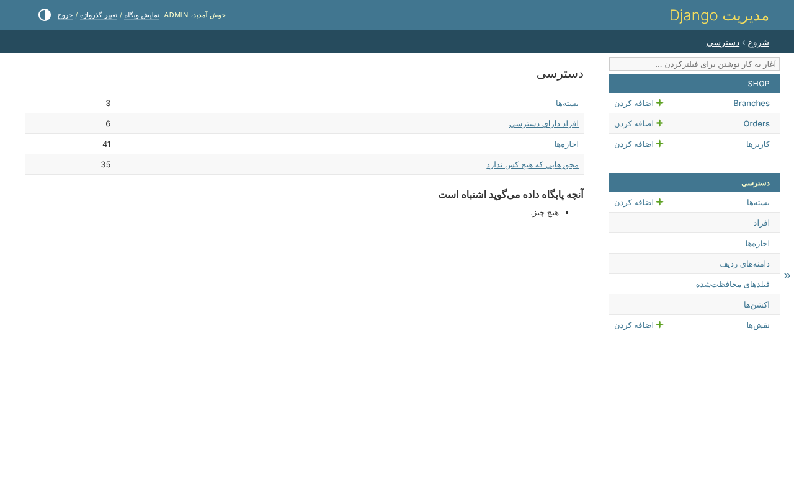

# ۱. اجرای فروشگاه

## راه انداختن

از ریشه‌ی مخزن، با کتابخانه نصب‌شده در یک محیط تازه:

```bash
python -m venv .venv && .venv/bin/pip install -e '.[drf]'
```

```bash
cd example
```

```bash
../.venv/bin/python manage.py migrate
```

```bash
../.venv/bin/python manage.py example_data
```

```bash
../.venv/bin/python manage.py createsuperuser
```

```bash
../.venv/bin/python manage.py runserver
```

`example_data` دو شعبه می‌سازد، *North* و *South*، چهار سفارش و پنج نفر. رمز عبور
هر نفر همان نام کاربری اوست - هیچ‌وقت روی یک پایگاه داده‌ی واقعی.

| با این وارد شوید | کیست | به چه می‌رسد |
|---|---|---|
| `north_manager` | مدیر شعبه | سفارش‌های North: خواندن، ویرایش، تأیید - هیچ‌وقت قیمت را نه |
| `south_manager` | مدیر شعبه | سفارش‌های South، به همان شکل |
| `accountant` | حسابدار | همه‌ی سفارش‌ها، با قیمتشان؛ بدون تغییر دادن چیزی |
| `alice`، `bob` | مشتری | سفارش‌های خودشان |

## تنظیمات چه می‌گویند

بخش کتابخانه در `config/settings.py`:

```python
--8<-- "example/config/settings.py:clearance"
```

و در `INSTALLED_APPS`، پنل ادمین کتابخانه به جای پنل Django، و سه اپ آن -
[نصب](../getting-started/installation.md) را ببینید.

## صفحه‌های دسترسی

در `/admin/` با ابرکاربر وارد شوید. زیر *دسترسی*، صفحه‌ی نمای کلی بسته‌ها،
نقش‌ها، افرادی که دسترسی دارند و هر چیزی را که `clearance_check` پیدا کرده
فهرست می‌کند:



بقیه‌ی آموزش فروشگاه را لایه به لایه باز می‌کند.
