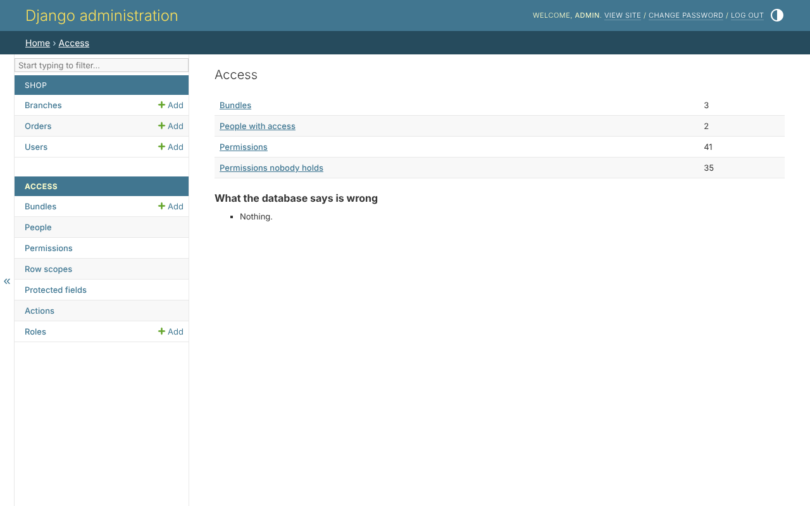

# 1. Running the shop

## Get it running

From the root of the repository, with the library installed in a fresh
environment:

```bash
python -m venv .venv && .venv/bin/pip install -e '.[drf]'
```

```bash
cd example
```

```bash
../.venv/bin/python manage.py migrate
```

```bash
../.venv/bin/python manage.py example_data
```

```bash
../.venv/bin/python manage.py createsuperuser
```

```bash
../.venv/bin/python manage.py runserver
```

`example_data` makes two branches, *North* and *South*, four orders, and five
people. Each sample password is the username - never on a real database.

| sign in as | is | reaches |
|---|---|---|
| `north_manager` | a branch manager | North's orders: read, edit, approve - never the price |
| `south_manager` | a branch manager | South's, the same |
| `accountant` | the accountant | every order, with its price; nothing changed |
| `alice`, `bob` | customers | their own orders |

## What the settings say

The library's part of `config/settings.py`:

```python
--8<-- "example/config/settings.py:clearance"
```

And in `INSTALLED_APPS`, the library's admin site in place of Django's, and
its three apps - see [installation](../getting-started/installation.md).

## The access pages

Sign in at `/admin/` as the superuser. Under *Access*, the overview lists the
bundles, the roles, the people with access, and anything `clearance_check`
found:



The rest of the tutorial takes the shop apart, a layer at a time.
