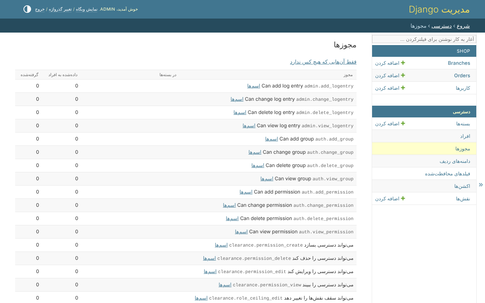

# ۲. مجوزها

مجوز کاری است که با یک مدل می‌شود کرد. Django به هر مدل چهار مجوز می‌دهد -
`view_order`، `add_order`، `change_order`، `delete_order` - و کتابخانه همان‌ها را
همان‌طور که هستند به کار می‌برد. فروشگاه به جای آن‌ها مجوزهای خودش را اعلام
می‌کند، که اسمشان کاری است که انجام می‌شود:

```python
--8<-- "example/shop/models.py:order"
```

`build_permissions` این‌ها را می‌سازد:

| مجوز | از کجا |
|---|---|
| `shop.order_view`، `order_create`، `order_edit`، `order_delete` | `DEFAULT_ACTIONS` |
| `shop.order_approve` | اکشنی که کنار آن‌ها اضافه شده |
| `shop.order_view_price`، `order_edit_price` | فیلد محافظت‌شده - قدم ۶ |

`default_permissions = ()` چهار مجوز Django را خاموش می‌کند، تا یک مدل یک
دسته اسم داشته باشد و نه دو دسته؛ مدلی که هر دو را نگه دارد موقع بالا آمدن
پروژه رد می‌شود (E014). اکشن وضعیت قدم ۷ است.

`permission_for(Order, 'edit')` به هر دو شکل جواب می‌دهد، پس هیچ جای دیگری از
پروژه لازم نیست بداند یک مدل کدام را نگه داشته.

## در پنل ادمین

*دسترسی*، *اجازه‌ها* همه‌ی مجوزها را فهرست می‌کند، و اینکه چه کسی هر کدام را
دارد:



مجوزی که وجود دارد تا وقتی کسی آن را ندهد به هیچ کس داده نشده: مجوز تازه‌ای که
در یک نسخه اضافه می‌شود، بدون دارنده می‌رسد.
