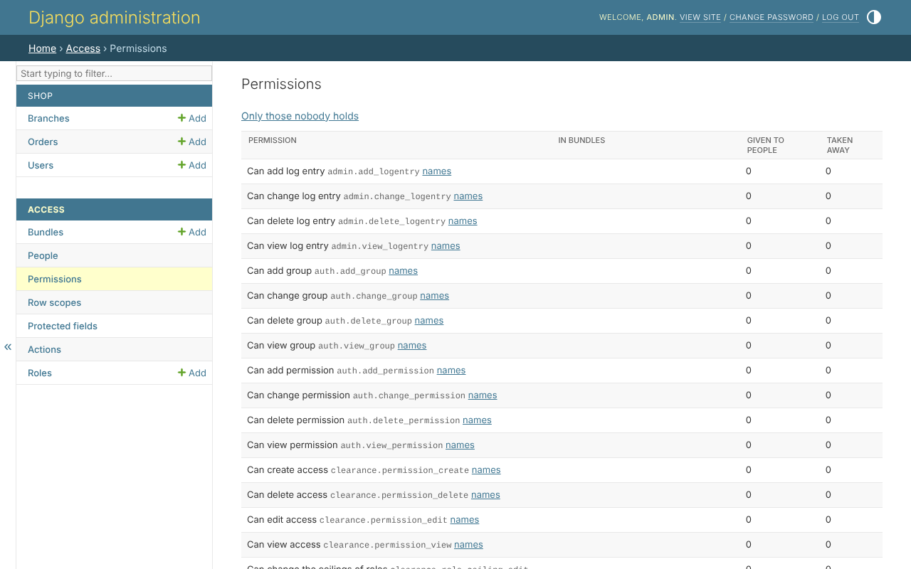

# 2. Permissions

A permission is what can be done to a model. Django gives every model four -
`view_order`, `add_order`, `change_order`, `delete_order` - and the library
uses them as they are. The shop declares its own instead, named after what is
done:

```python
--8<-- "example/shop/models.py:order"
```

`build_permissions` makes:

| permission | from |
|---|---|
| `shop.order_view`, `order_create`, `order_edit`, `order_delete` | `DEFAULT_ACTIONS` |
| `shop.order_approve` | the action added beside them |
| `shop.order_view_price`, `order_edit_price` | the protected field - step 6 |

`default_permissions = ()` turns Django's four off, so a model has one set of
names and not two; start-up refuses a model that keeps both (E014). The
status action is step 7.

`permission_for(Order, 'edit')` answers either style, so nothing else in the
project has to know which a model keeps.

## In the admin site

*Access*, *Permissions* lists every permission, and who holds it:



A permission that exists is given to nobody until somebody gives it: a new
one, added in a release, arrives held by nobody.
