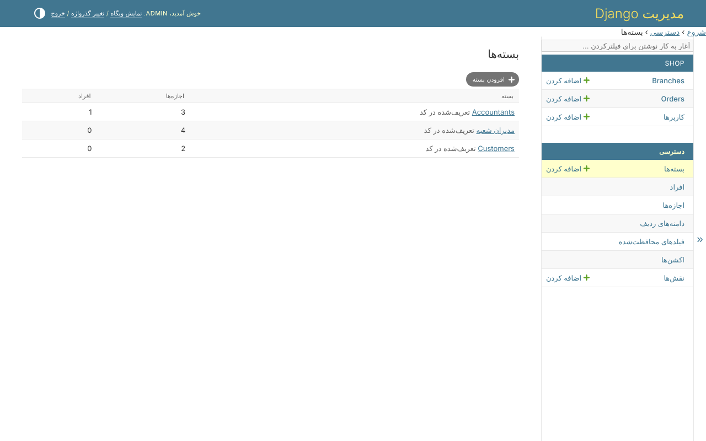
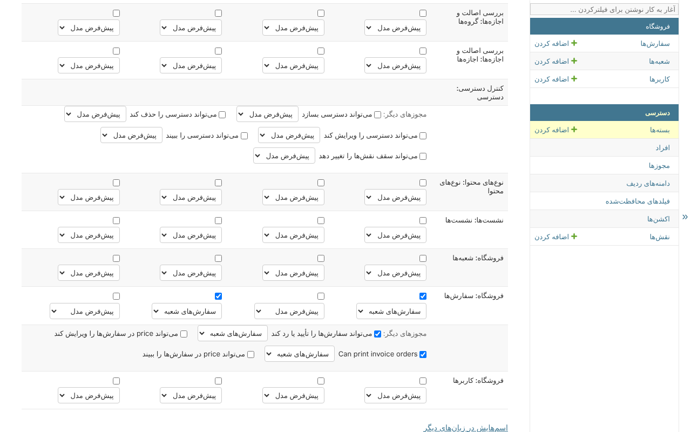
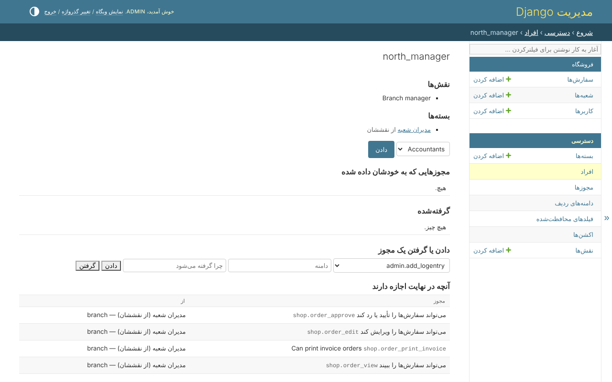

# ۳. بسته‌ها

بسته همان `Group` در Django است: مجوزهایی که با هم داده می‌شوند. هر مجوزی که در
آن است یک **دامنه** دارد - اینکه به کدام ردیف‌ها می‌رسد. هر شخص همان چیزی را
دارد که بسته‌هایش به او می‌دهند.

## فهرست

*دسترسی*، *بسته‌ها*:



## یک بسته

یک بسته یک جدول است: در هر ردیف یک مدل، در هر ستون یک اکشن، و کنار هر مجوزی که
داده شده یک دامنه. بسته‌ی *Branch managers* در فروشگاه `view`، `edit`، `approve`
و `print_invoice` را روی سفارش‌ها می‌دهد، هر کدام در دامنه‌ی *سفارش‌های
شعبه‌شان*:



اکشنی که در چهار ستون نیست - `approve`، قیمت، اکشنی که در کد پیدا شده - زیر
*مجوزهای دیگر*، در سطر خود مدل است. زیر جدول، صفحه دارندگان بسته را فهرست
می‌کند.

## یک شخص

*دسترسی*، *افراد*، و یک شخص: نقش‌هایش، بسته‌هایش، مجوزهایی که مستقیم به خودش
داده شده، آنچه از او گرفته شده - و آنچه در نهایت اجازه دارد، با اینکه هر مجوز
از کجا آمده:



از همین صفحه یک بسته داده می‌شود، و یک مجوز به یک شخص داده یا از او گرفته
می‌شود، هر چه بسته‌هایش بگویند، همراه با دلیل گرفتن آن.

## در کد

صفحه‌ها `AccessService` را صدا می‌زنند؛ یک پروژه هم می‌تواند:

```python
from clearance.services import AccessService

access = AccessService(actor=request.user)

managers = access.create_bundle(
    'Branch managers',
    grants={'shop.order_view': 'branch', 'shop.order_edit': 'branch'},
)
access.give_bundle(person, managers)
access.revoke(person, 'shop.order_edit', reason='Under review')
```

کسی که تغییری می‌دهد نمی‌تواند بیشتر از آنچه خودش دارد بدهد، و نمی‌تواند
دسترسی خودش را تغییر دهد: هر بار از `actor` پرسیده می‌شود.
