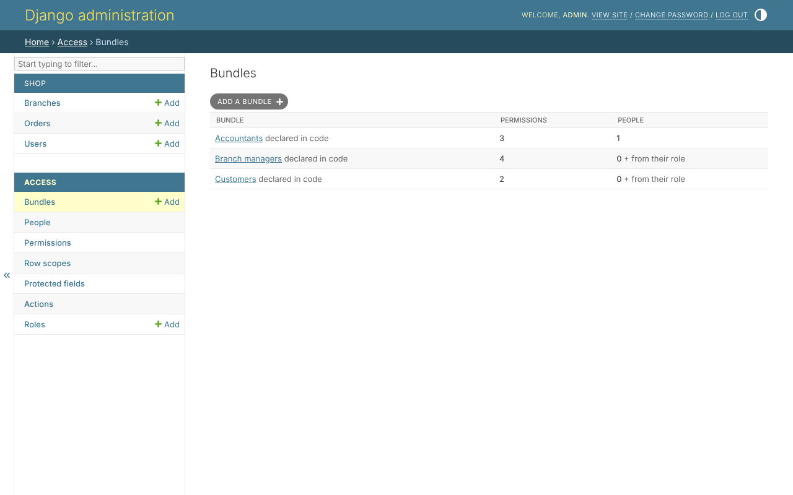
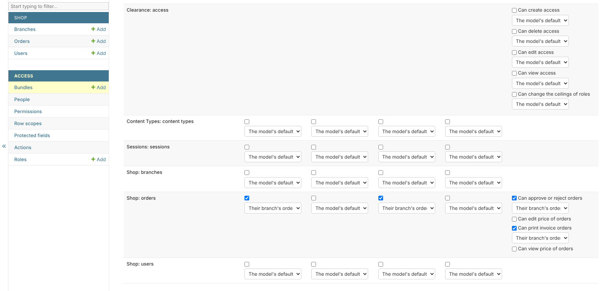
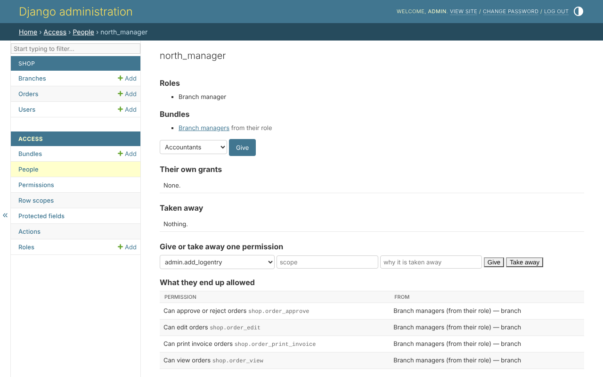

# 3. Bundles

A bundle is Django's `Group`: permissions given together. Each permission in
it carries a **scope** - which rows it reaches. A person holds what their
bundles give.

## The list

*Access*, *Bundles*:



## One bundle

A bundle is a grid: a model in each row, an action in each column, and a
scope beside each permission given. The shop's *Branch managers* gives
`view`, `edit`, `approve` and `print_invoice` on orders, each in *Their
branch's orders*:



An action the four columns do not hold - `approve`, the price, an action
found in the code - is under *Other permissions*, on the model's own line.
Below the grid, the page lists who holds the bundle.

## One person

*Access*, *People*, and a person: their roles, their bundles, their own
grants, what was taken away from them - and what they end up allowed, with
where each permission came from:



From this page, a bundle is given, and one permission is given or taken away
from one person, whatever their bundles say, with the reason it was taken.

## In code

The pages call `AccessService`; so can a project:

```python
from clearance.services import AccessService

access = AccessService(actor=request.user)

managers = access.create_bundle(
    'Branch managers',
    grants={'shop.order_view': 'branch', 'shop.order_edit': 'branch'},
)
access.give_bundle(person, managers)
access.revoke(person, 'shop.order_edit', reason='Under review')
```

Whoever makes a change may not give more than they hold, nor change their
own access: the actor is asked every time.
