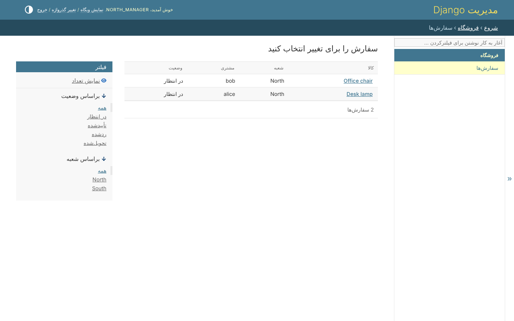

# ۴. دامنه‌های ردیف در کد

دامنه می‌گوید یک مجوز به کدام ردیف‌ها می‌رسد. یک مدل دامنه‌هایش را روی queryset
خودش تعریف می‌کند:

```python
--8<-- "example/shop/querysets.py"
```

هر دامنه یک اسم است، یک برچسب که پنل ادمین نشان می‌دهد، و متدی که برای شخص یک
`Q` برمی‌گرداند. `all` همیشه کنار آن‌ها هست. سفارش این queryset را مدیر
(manager) خودش می‌کند - `objects = OrderQuerySet.as_manager()`، در قدم ۲.

## خواستن ردیف‌ها

```python
Order.objects.visible_to(user)            # the orders they may view
Order.objects.visible_to(user, 'edit')    # the orders they may edit
```

برای افراد فروشگاه:

| شخص | چه دارد | `visible_to(person)` |
|---|---|---|
| `north_manager` | `order_view` در `branch` | چراغ مطالعه و صندلی اداری - سفارش‌های North |
| `accountant` | `order_view` در `all` | هر چهار سفارش |
| `alice` | `order_view` در `own` | چراغ مطالعه و قفسه‌ی کتاب - سفارش‌های خودش |
| کسی که چیزی به او داده نشده | هیچ | هیچ |

مجوزهای یک شخص در هر درخواست یک بار و با تعداد ثابتی کوئری خوانده می‌شوند، هر
چند فهرست که یک صفحه نشان دهد.

## همه‌ی درها از همین می‌پرسند

پنل ادمین، viewهای Django و API همه از همین `visible_to` می‌پرسند. با
`north_manager`، فهرست سفارش‌ها در پنل ادمین سفارش‌های North را دارد و نه چیز
دیگری - و قیمتی ندارد، که قدم ۶ است:



سفارش شعبه‌ی دیگر برای آن‌ها رد نمی‌شود: برایشان وجود ندارد، همان 404 سفارشی
که هیچ‌وقت ثبت نشده.

## نوشتن ردیف‌ها

دامنه برای آنچه نوشته می‌شود هم برقرار است: سفارشی که بیرون از دامنه‌ی `create`
ساخته شود، یا با ویرایش از ردیف‌هایی که شخص به آن‌ها می‌رسد بیرون برود، رد
می‌شود و نوشتنش برگردانده می‌شود.
