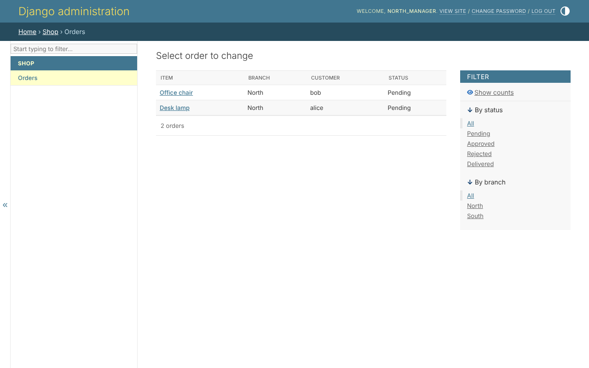

# 4. Row scopes in code

A scope says which rows a permission reaches. A model offers its scopes on
its queryset:

```python
--8<-- "example/shop/querysets.py"
```

Each scope is a name, a label the admin site shows, and a method that
answers a `Q` for the person. `all` is always offered beside them. The order
uses the queryset as its manager - `objects = OrderQuerySet.as_manager()`,
in step 2.

## Asking for rows

```python
Order.objects.visible_to(user)            # the orders they may view
Order.objects.visible_to(user, 'edit')    # the orders they may edit
```

For the shop's people:

| person | holds | `visible_to(person)` |
|---|---|---|
| `north_manager` | `order_view` in `branch` | the desk lamp and the office chair - North's |
| `accountant` | `order_view` in `all` | all four |
| `alice` | `order_view` in `own` | the desk lamp and the bookshelf - hers |
| somebody given nothing | nothing | nothing |

A person's grants are read once per request, in a fixed number of queries,
however many lists a page shows.

## Every door asks it

The admin site, Django's views and the API all ask the same `visible_to`.
Signed in as `north_manager`, the admin site's list of orders holds North's
and nothing else - and no price, which is step 6:



An order of another branch is not refused to them: it does not exist for
them, the same 404 as an order that was never placed.

## Writing rows

A scope holds for what is written too: an order created outside the scope
`create` was given in, or edited out of the rows the person reaches, is
refused and the write undone.
