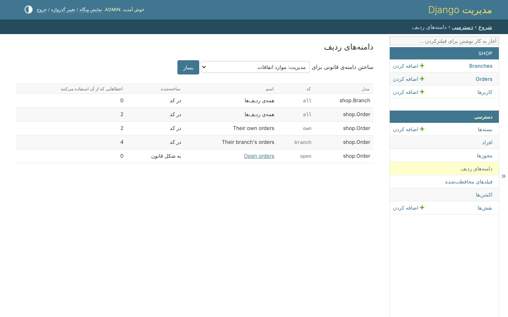
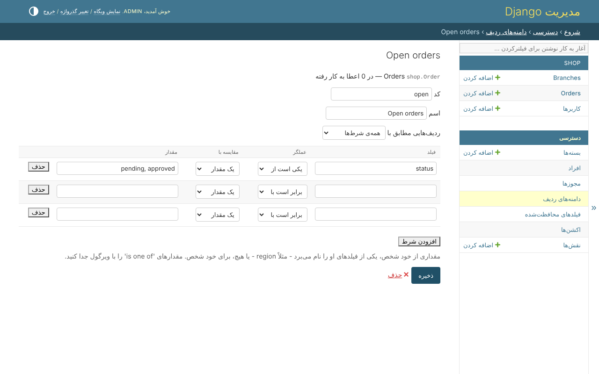

# ۵. دامنه‌های قانونی در پنل ادمین

دامنه‌ی کد را یک برنامه‌نویس می‌نویسد. مدیر سیستم دامنه‌های بیشتری می‌سازد، بدون
کد و بدون استقرار دوباره: *دسترسی*، *دامنه‌های ردیف*.



## ساختن یک دامنه

یک قانون یک اسم دارد، *همه‌ی شرط‌ها* یا *هر کدام از شرط‌ها*، و خود شرط‌ها -
هر کدام یک فیلد، یک عملگر، و چیزی که با آن مقایسه می‌شود: یک مقدار، یا چیزی
مال شخص. *Open orders* - سفارش‌هایی که هنوز در انتظار یا تأییدشده‌اند:



```text
status      is one of   pending, approved
```

وقتی با چیزی مال شخص مقایسه شود، یک قانون همان را می‌گوید که دامنه‌ی کد می‌گوید:

```text
branch      is          the person's branch
```

بعد از ذخیره، قانون کنار هر مجوز سفارش‌ها پیشنهاد می‌شود، در جدول بسته و در
صفحه‌ی شخص، همان‌طور که *سفارش‌های شعبه‌شان* پیشنهاد می‌شود.

## آنچه یک قانون نمی‌تواند بگوید

یک قانون همیشه فقط یک `Q` در Django است، که موقع ذخیره بررسی می‌شود:

* هیچ‌وقت فیلد محافظت‌شده یا رمز عبور را نمی‌خواند - به دارنده‌ی قانون می‌گفت
  آن فیلد چه دارد؛
* حداکثر از `RULE_DEPTH` رابطه عبور می‌کند؛
* شرطی که به مدل دیگری می‌رسد - `customer__email` - آن مدل را می‌خواند، پس کسی
  که قانون را می‌نویسد باید اجازه‌ی دیدن همه‌ی آن را داشته باشد.

قانونی که دیگر درست درنمی‌آید - فیلدش از مدل حذف شده، یا از آن به بعد محافظت
شده - تا وقتی درست نشود به هیچ ردیفی نمی‌رسد، نه به همه‌ی ردیف‌ها؛
`clearance_check` آن را فهرست می‌کند.
