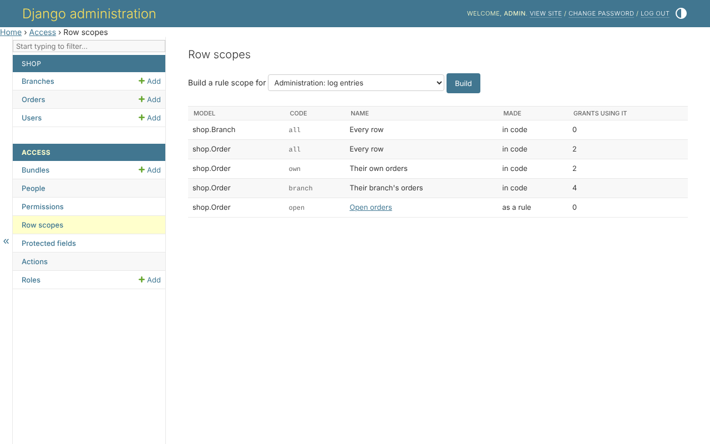
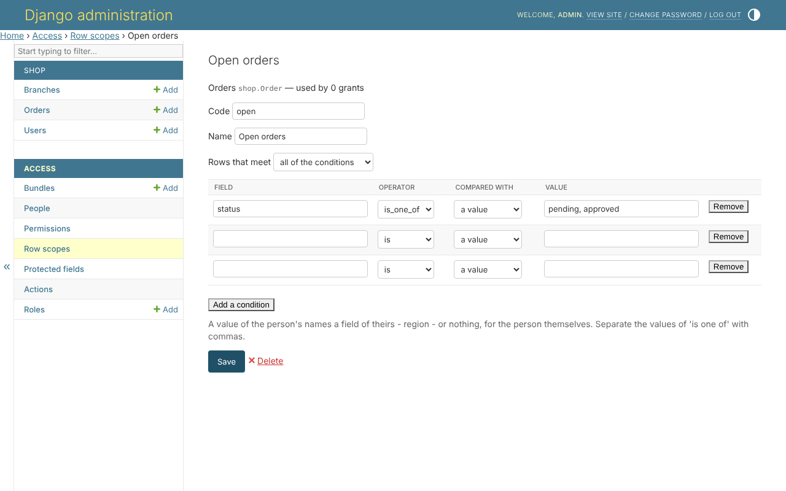

# 5. Rule scopes in the admin site

A scope in code is written by a developer. An administrator builds more,
with no code and no deployment: *Access*, *Row scopes*.



## Building one

A rule is a name, *all of* or *any of* the conditions, and the conditions -
each a field, an operator, and what it is compared with: a value, or
something of the person's. *Open orders* - the orders still pending or
approved:



```text
status      is one of   pending, approved
```

Compared with something of the person's, a rule says what a scope in code
says:

```text
branch      is          the person's branch
```

Once saved, the rule is offered beside every permission on orders, in the
bundle grid and on a person's page, as *Their branch's orders* is.

## What a rule may not say

A rule is only ever a Django `Q`, checked when it is saved:

* it never reads a protected field, or the password - it would tell whoever
  holds the rule what the field holds;
* it crosses at most `RULE_DEPTH` relations;
* a condition reaching another model - `customer__email` - reads that model,
  so whoever writes the rule must be allowed to view all of it.

A rule that no longer checks out - its field removed from the model, or
protected since - reaches nothing, rather than everything, until it is
mended; `clearance_check` lists it.
