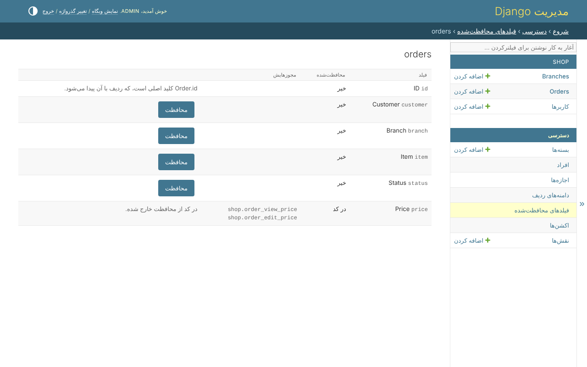
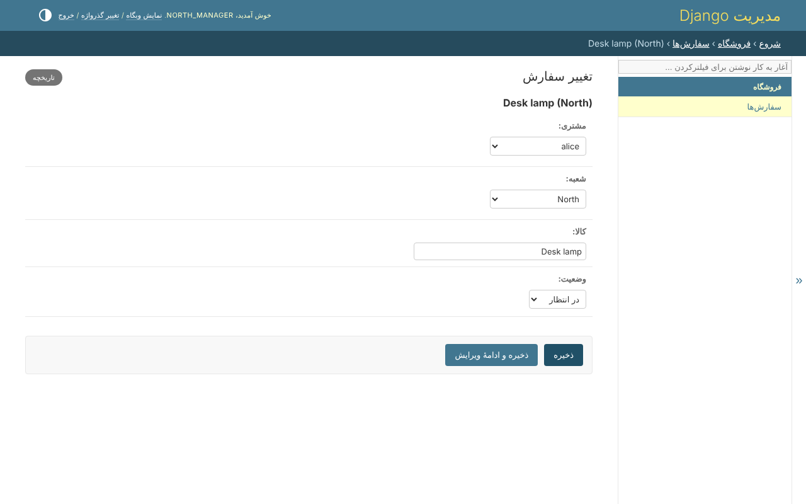

# ۶. فیلدهای محافظت‌شده

قیمت را فروشگاه تعیین می‌کند و حسابدار می‌خواند. مدیر سفارش را می‌خواند و
هیچ‌وقت قیمت را نه؛ مشتری هیچ‌وقت آن را نمی‌نویسد.

## محافظت از یک فیلد

در مدل، کنار مجوزهایش:

```python
permissions = build_permissions(
    'order',
    _('orders'),
    protected_fields=('price',),
)
```

این دو مجوز اضافه می‌کند: `shop.order_view_price` و `shop.order_edit_price`. یا
بدون کد، *دسترسی*، *فیلدهای محافظت‌شده*، مدل، *محافظت*:



از کلید اصلی نمی‌شود محافظت کرد: ردیف با آن پیدا می‌شود.

## چه چیزی را تغییر می‌دهد

فیلدی که شخص اجازه‌ی خواندنش را ندارد از همه‌ی درها کنار گذاشته می‌شود - API،
فرم‌ها و قالب‌های Django، فرم‌ها، فهرست‌ها، جستجو، فیلترها و مرتب‌سازی پنل ادمین،
و قانون‌ها. حسابدار `order_view_price` را دارد؛ مدیرها ندارند. همان سفارش، وقتی
`north_manager` بازش کند، قیمت ندارد:



فیلدی که می‌تواند بخواند و نمی‌تواند بنویسد، نشان داده و قفل می‌شود. نوشتنی که
اسم آن را بیاورد - `"price": "1.00"` که یک مشتری به API بفرستد - یک 400 است که
اسم فیلد را می‌برد، نه اینکه بی‌صدا کنار گذاشته شود.

## در کد

```python
from clearance.fields import readable_fields, writable_fields

readable_fields(user, Order)   # {'id', 'customer', 'branch', 'item', 'status'}
writable_fields(user, Order)
```
