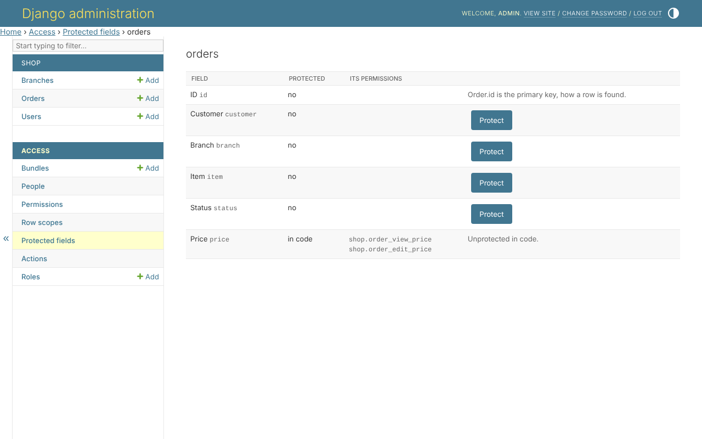
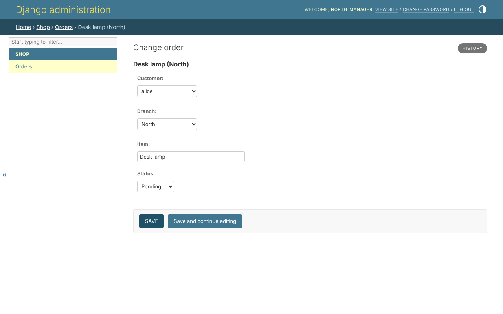

# 6. Protected fields

The price is the shop's to set and the accountant's to read. A manager reads
the order and never the price; a customer never writes it.

## Protecting a field

In the model, beside its permissions:

```python
permissions = build_permissions(
    'order',
    _('orders'),
    protected_fields=('price',),
)
```

That adds two permissions: `shop.order_view_price` and
`shop.order_edit_price`. Or with no code, *Access*, *Protected fields*, the
model, *Protect*:



The primary key cannot be protected: it is how a row is found.

## What it changes

A field the person may not read is left out of every door - the API, Django's
forms and templates, the admin site's forms, lists, search, filters and
ordering, and rules. The accountant holds `order_view_price`; the managers do
not. The same order, opened by `north_manager`, has no price:



A field they may read and not write is shown and locked. A write that names
it - `"price": "1.00"` sent to the API by a customer - is a 400 naming the
field, not a silent drop.

## In code

```python
from clearance.fields import readable_fields, writable_fields

readable_fields(user, Order)   # {'id', 'customer', 'branch', 'item', 'status'}
writable_fields(user, Order)
```
