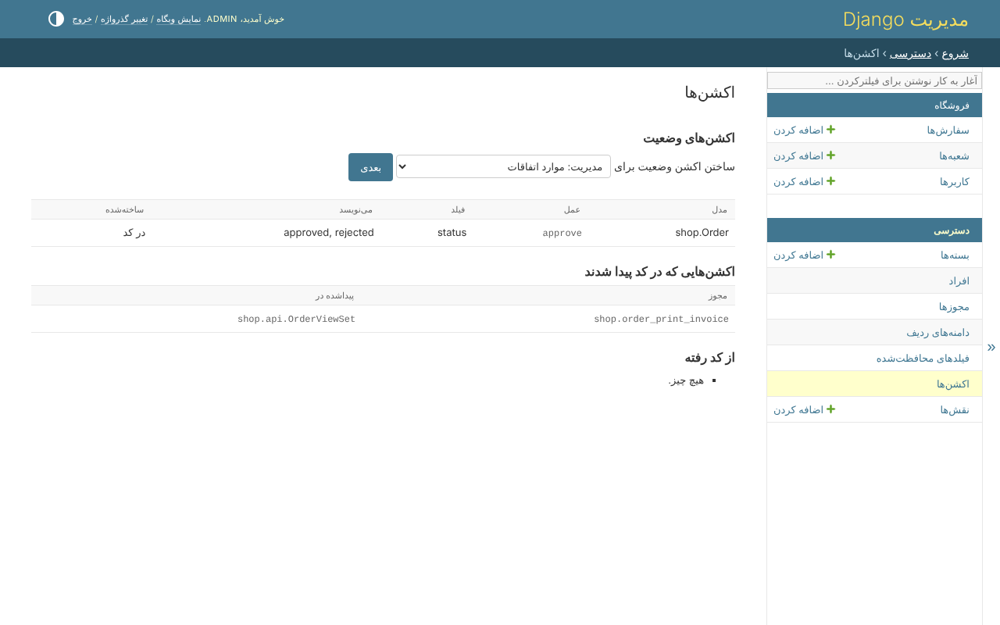

# ۷. اکشن‌های وضعیت

هر کسی که بتواند سفارشی را ویرایش کند می‌تواند کالای آن را اصلاح کند. فقط کسی که
اجازه‌ی تأیید دارد آن را *تأییدشده* یا *ردشده* می‌کند - و فقط تا وقتی *در
انتظار* است.

## اعلام یک اکشن وضعیت

کنار مجوزهای مدل، از قدم ۲:

```python
permissions = build_permissions(
    'order',
    _('orders'),
    actions=(*DEFAULT_ACTIONS, 'approve'),
    status_actions={
        'approve': {'field': 'status', 'to': ['approved', 'rejected'], 'from': ['pending']},
    },
)
```

`approve` مقدارهای `approved` و `rejected` را می‌نویسد، از `pending`. مقداری که
هیچ اکشنی ادعایش را نکرده - `pending`، `delivered` - را هر کسی که بتواند سفارش را
ویرایش کند می‌نویسد.

یا بدون کد، *دسترسی*، *اکشن‌ها*، که اکشن‌هایی را هم که در کد پیدا شده‌اند فهرست
می‌کند - `print_invoice`، قدم ۹:



## چه چیزی را تغییر می‌دهد

فرم‌ها و serializerها فقط مقدارهایی را پیشنهاد می‌کنند که شخص می‌تواند بنویسد.
مدیر شعبه `order_approve` را در شعبه‌ی خودش دارد: روی یک سفارش در انتظار در
North، به `north_manager` هر چهار مقدار پیشنهاد می‌شود. سفارشی که تأیید شده دوباره
تأیید نمی‌شود: `approve` فقط از *در انتظار* می‌نویسد.

```python
from clearance.actions import writable_values

writable_values(user, Order, 'status', order)
```

مقدار وضعیتی که شخص اجازه‌ی نوشتنش را ندارد، اگر به API فرستاده شود، یک 400 است
که اسم فیلد را می‌برد.
