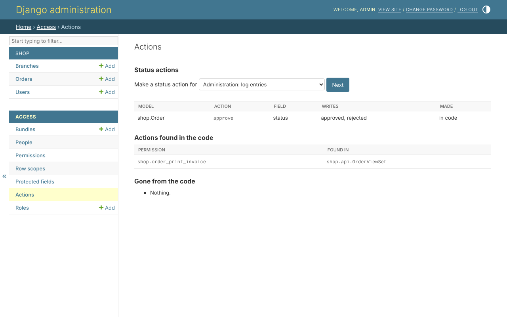

# 7. Status actions

Anybody who may edit an order may correct its item. Only whoever may approve
sets it to *approved* or *rejected* - and only while it is *pending*.

## Declaring one

Beside the model's permissions, from step 2:

```python
permissions = build_permissions(
    'order',
    _('orders'),
    actions=(*DEFAULT_ACTIONS, 'approve'),
    status_actions={
        'approve': {'field': 'status', 'to': ['approved', 'rejected'], 'from': ['pending']},
    },
)
```

`approve` writes `approved` and `rejected`, from `pending`. A value no action
claims - `pending`, `delivered` - is written by whoever may edit the order.

Or with no code, *Access*, *Actions*, which also lists the actions found in
the code - `print_invoice`, step 9:



## What it changes

Forms and serializers offer only the values the person may write. A branch
manager holds `order_approve` in their branch: on a pending order of North,
`north_manager` is offered all four. An order already approved cannot be
approved again: `approve` writes only from *pending*.

```python
from clearance.actions import writable_values

writable_values(user, Order, 'status', order)
```

A status value the person may not set, sent to the API, is a 400 naming the
field.
