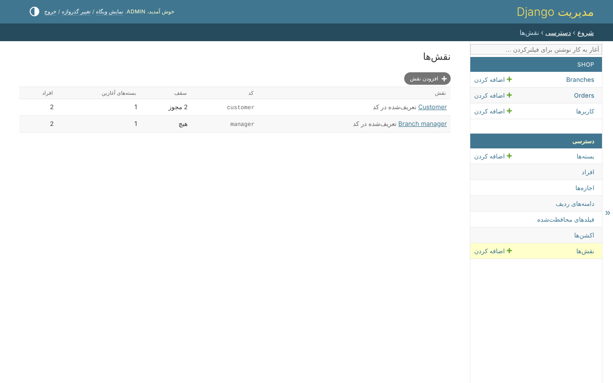
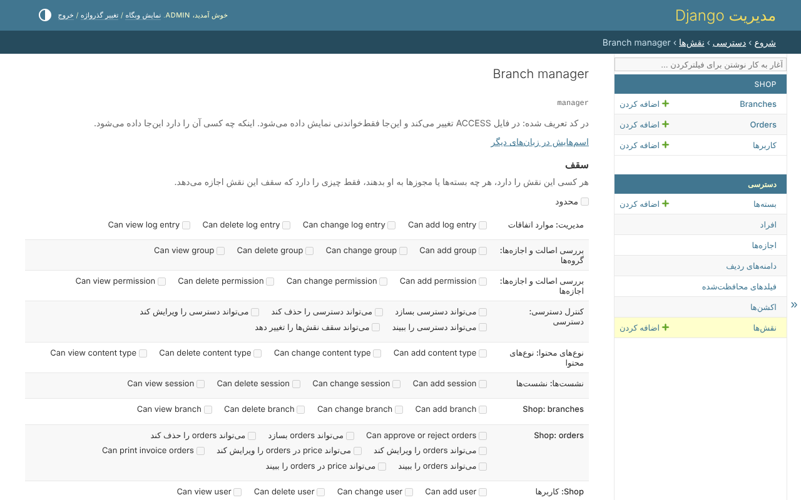

# ۱۰. نقش‌ها

وقتی `clearance.roles` نصب باشد، نقش چیزی است که یک شخص هست - مشتری، مدیر شعبه.
دو چیز می‌دهد:

* **بسته‌های شروع** - هر کسی که این نقش را دارد آن‌ها را دارد، بی آنکه یکی یکی
  به او داده شوند؛
* **یک سقف** - بیشترین چیزی که هر کسی با این نقش می‌تواند داشته باشد، هر چه یک
  بسته یا مجوز مستقیم به او بدهد. نقشی که سقف ندارد چیزی را محدود نمی‌کند.

*دسترسی*، *نقش‌ها*:



## یک نقش

*Branch manager* با بسته‌ی *Branch managers* شروع می‌شود، و سقف ندارد:



*Customer* سقفی از `order_view` و `order_create` دارد. بسته‌ای که `order_edit`
می‌دهد، اگر اشتباهی به یک مشتری داده شود، چیزی به او نمی‌دهد: سقف هر بار، بعد
از بسته‌ها و مجوزهای مستقیم، پرسیده می‌شود.

## در کد

```python
from clearance.roles.models import Role
from clearance.roles.services import RoleService
from clearance.roles.resolvers import has_role

RoleService(actor=request.user).assign(person, Role.objects.get(code='customer'))

has_role(person, 'customer')    # True
```

`ROLE_RESOLVER` می‌گوید نقش‌های یک شخص را چه چیزی می‌خواند. `AttributeResolver`
آن‌ها را از خود کاربر می‌خواند - از فیلدی که `ROLE_ATTRIBUTE` نام می‌برد، و فقط
ابرکاربر در پنل ادمین آن را می‌نویسد، چون نوشتن آن یعنی دادن یک نقش.

تغییر دادن یک سقف مجوز خودش را لازم دارد، `clearance.role_ceiling_edit`: بالا
بردن سقف یعنی دادن چیز بیشتر به همه‌ی دارندگان آن نقش.
