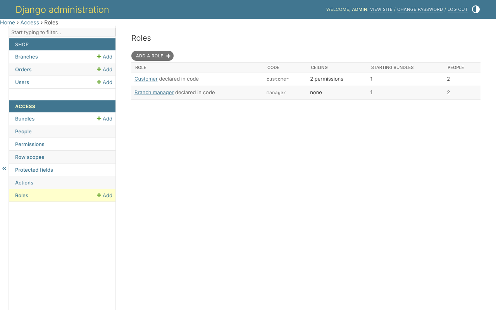
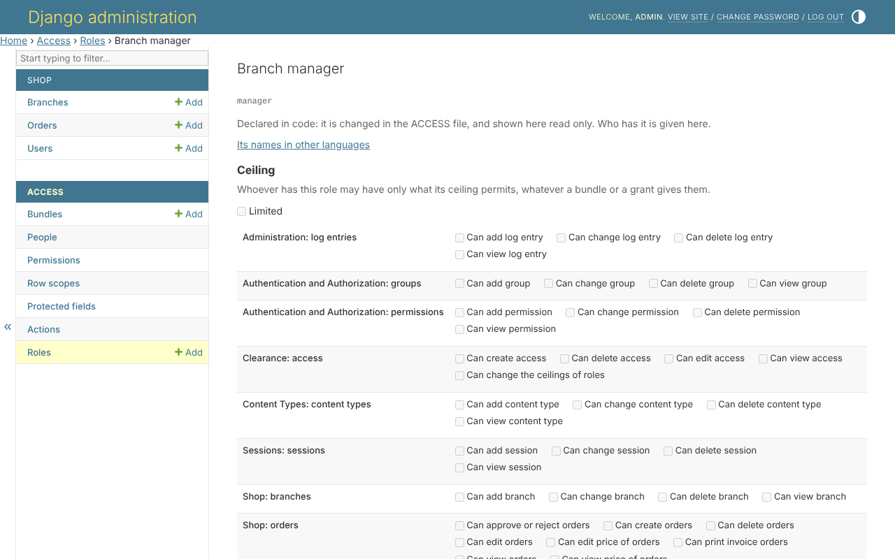

# 10. Roles

With `clearance.roles` installed, a role is what a person is - a customer, a
branch manager. It gives two things:

* **starting bundles** - everybody with the role holds them, without being
  given them one by one;
* **a ceiling** - the most anybody with the role may ever hold, whatever a
  bundle or a grant gives them. A role with no ceiling limits nothing.

*Access*, *Roles*:



## One role

*Branch manager* starts with the bundle *Branch managers*, and has no
ceiling:



*Customer* has a ceiling of `order_view` and `order_create`. A bundle giving
`order_edit`, given to a customer by mistake, gives them nothing: the
ceiling is asked every time, after the bundles and grants.

## In code

```python
from clearance.roles.models import Role
from clearance.roles.services import RoleService
from clearance.roles.resolvers import has_role

RoleService(actor=request.user).assign(person, Role.objects.get(code='customer'))

has_role(person, 'customer')    # True
```

`ROLE_RESOLVER` names what reads a person's roles. `AttributeResolver` reads
them off the user instead - a field named by `ROLE_ATTRIBUTE`, which only the
superuser writes in the admin site, because writing it is giving a role.

Changing a ceiling takes its own permission,
`clearance.role_ceiling_edit`: raising the ceiling is giving every
holder of the role more.
