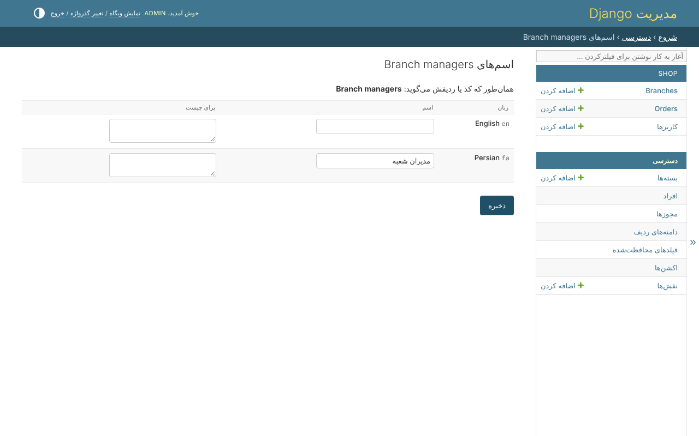

# ۱۲. اسم‌ها در همه‌ی زبان‌ها

صفحه‌ها، پیام‌ها و اسم مجوزهای خود کتابخانه به انگلیسی و فارسی هستند. catalogue
خود پروژه برچسب‌هایی را که به `build_permissions` می‌دهد ترجمه می‌کند -
`_('orders')`، `_('Can approve or reject %(resource)s')` - همان‌طور که بقیه‌ی
چیزها را ترجمه می‌کند.

## اسم‌هایی که مدیر سیستم می‌دهد

بسته یا نقش موقع اجرا ساخته می‌شود، پس هیچ catalogueای اسم آن را ندارد. وقتی
`clearance.translations` نصب باشد، مدیر سیستم یک مجوز، یک بسته یا یک نقش را در هر
زبانی از `LANGUAGES` نام‌گذاری می‌کند، از صفحه‌ی خود آن - *اسم‌هایش در زبان‌های
دیگر*:



همان بسته، وقتی به فارسی خوانده شود، با صفحه‌های راست به چپ:


اسم از زبان خواننده خوانده می‌شود، بعد از زبان پایه‌ی آن، بعد از آنچه کد
می‌گوید، و بعد از خود ردیف.

## در کد

```python
from clearance.labels import label_of, labels_in

label_of(bundle)                      # in the active language
labels = labels_in('fa')              # every name of a language, in one query
labels.of(permission)
```

```django
{{ bundle|label:labels }}
```

## قدم بعدی

فروشگاه کامل شد. [راهنما](../guide.md) همه‌ی بخش‌های کتابخانه را با جزئیات دارد،
و [طراحی](../design.md) اینکه چرا این‌طور ساخته شده.
