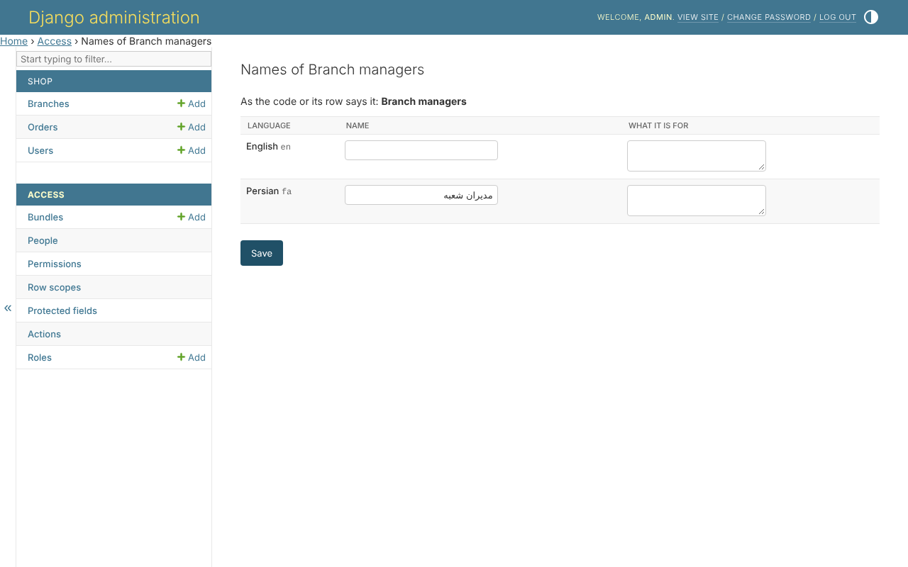

# 12. Names in every language

The library's own pages, messages and permission names come in English and
Persian. A project's own catalogue translates the labels it gives
`build_permissions` - `_('orders')`, `_('Can approve or reject %(resource)s')`
- as it translates everything else.

## Names an administrator gives

A bundle or a role is made at runtime, so no catalogue holds its name. With
`clearance.translations` installed, an administrator names a permission, a
bundle or a role in every language of `LANGUAGES`, from its page - *Its names
in other languages*:



The same bundle, read in Persian, with the pages right to left:


A name is read from the reader's language, then its base language, then
what the code says, then the row.

## In code

```python
from clearance.labels import label_of, labels_in

label_of(bundle)                      # in the active language
labels = labels_in('fa')              # every name of a language, in one query
labels.of(permission)
```

```django
{{ bundle|label:labels }}
```

## Where next

That is the whole shop. The [guide](../guide.md) has every part of the
library in detail, and the [design](../design.md) why it is built the way it
is.
